# Alfa — lead your pack / guía a tu manada

### 🐺 The all-in-one for World of Warcraft: Forever · El todo en uno para WoW: Forever

**One addon instead of twenty.** Guides, route, map, bags, talents, encyclopedia, dungeons, healing, fishing, trading and your guild — tidy, guided and with one look. And **Lya**, a black she-wolf companion who chats with you along the way. **Free · open source · 10 languages · needs no other addon.**

**Un solo addon en vez de veinte.** Guías, ruta, mapa, bolsas, talentos, enciclopedia, mazmorras, curación, pesca, comercio y tu clan, ordenado, guiado y con un solo estilo. Y **Lya**, una loba negra que te acompaña y platica contigo. **Gratis · código abierto · 10 idiomas · no necesita ningún otro addon.**

*Every login starts with the wolf and the moon. · Cada entrada empieza con el lobo y la luna.*

---

## 🆕 New in 1.3.9 — the pack hunts better / Lo nuevo: la manada caza mejor

**Your quests, your professions and 100+ improvements.** · **Tus misiones, tus oficios y más de 100 mejoras.**

**📜 Close my quests / Cerrar mis misiones** — one click builds the best route with all your quests: each zone in one go, turn-ins grouped by NPC, and quests that no longer give experience set aside "For later". Your route shows on the map with numbered stops. · Con un clic arma la mejor ruta con todas tus misiones: cada zona de una vez, las entregas juntas por PNJ, y las que ya no dan experiencia van a «Para después». Tu ruta sale en el mapa con paradas numeradas.

**⛏️ Profession guides that really help / Guías de profesión que sí ayudan** — Alfa's own guides by stage: the best zone with its route, the cheapest recipe that still gives points, when to visit the trainer and your materials minus what your other characters hold. "Reset this guide" finds where you are; "Take me" to an ore sends you to the most likely zone for your level. · Guías propias de Alfa por tramos: la mejor zona con su ruta, la receta más barata que aún da puntos, cuándo ir al instructor y tus materiales con lo de tus otros personajes descontado. «Restablecer esta guía» te ubica solo, y «Llévame» a un mineral te manda a la zona más probable para tu nivel.

**⛵ Travel, rebuilt the Alfa way / El viaje, nuevo y a la manera de Alfa** — boats, zeppelins, trams, portals and flights get their own card with a big departure countdown, the route and its stage. Clicking the arrow takes you to the next spot again. · Barcos, zepelines, tranvías, portales y vuelos tienen su tarjeta con la cuenta grande de la salida, la ruta y su momento. El clic en la flecha vuelve a llevarte al siguiente lugar.

**🐺 The Big Bad Wolf hunts bugs / El Lobo Malo caza bichos** — if Alfa hits one of its own errors it tells you quietly and you report it in one click; it never includes your name or realm. · Si Alfa encuentra un error suyo te avisa en chiquito y lo reportas con un clic; nunca lleva tu nombre ni tu reino.

**🏰 Dungeons from the inside / Mazmorras por dentro** — an inside map with zoom, floors and your progress through the bosses, plus a "Before you enter" checklist that ticks itself. · Un mapa por dentro con zoom, pisos y tu avance por jefes, y una lista «Antes de entrar» que se marca sola.

**⚔️ Horde and Alliance / Horda y Alianza** — a La Jauría scoreboard by faction, "Wolves with Alfa" (who in your guild uses Alfa and who needs to update) and an optional faction theme. · Marcador de La Jauría por bando, «Lobos con Alfa» (quién de tu hermandad usa Alfa y quién debe actualizar) y temática por bando opcional.

**✨ And more / Y más** — Today shows the first thing to do, a 3-screen setup, a notification center, smarter bag search and sorting, the fishing window simplified, healing click maps per spec, your last 5 fights, and many fixes. · Hoy pone primero lo que conviene hacer, configuración en 3 pantallas, centro de avisos, búsqueda y orden de bolsas más listos, ventana de pesca más sencilla, mapas de clics por especialización, tus últimas 5 peleas y muchos arreglos. [Full notes / Notas completas](https://github.com/toxic3000/alfa-forever/blob/main/CHANGELOG.md)

> If something breaks, tell us with `/alfa reportar`, on [Discord](https://discord.gg/hUNjA6BJwh), in the comments or on [GitHub](https://github.com/toxic3000/alfa-forever/issues). · Si algo falla, avísanos con `/alfa reportar`, en el [Discord de La Jauría](https://discord.gg/hUNjA6BJwh), en los comentarios o en [GitHub](https://github.com/toxic3000/alfa-forever/issues).

---

## 1.3.8 — the pack on two screens / la manada en dos pantallas

**Alfa on your second monitor and 40 improvements.** · **Alfa en tu segundo monitor y 40 mejoras.**

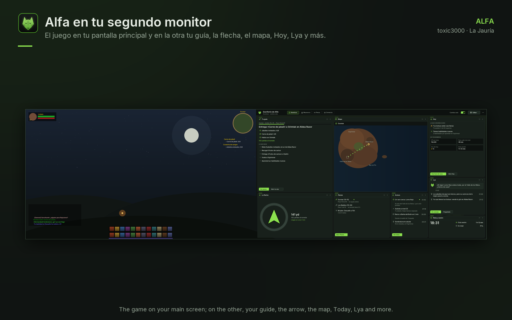

**🖥️ Two screens / Dos pantallas** — the game stays on your main monitor and the other one shows your live panels: your guide in big, the arrow, the map, Today, Lya, your group and more. If Alfa sees another monitor, it offers it once and sets it up in one click; you try it for 15 seconds before keeping it. `/alfa pantallas` · El juego se queda en tu monitor principal y en el otro van tus paneles en vivo: tu guía en grande, la flecha, el mapa, Hoy, Lya, tu grupo y más. Si Alfa ve otro monitor, te lo ofrece una vez y lo pone en un clic; lo pruebas 15 segundos antes de quedártelo.

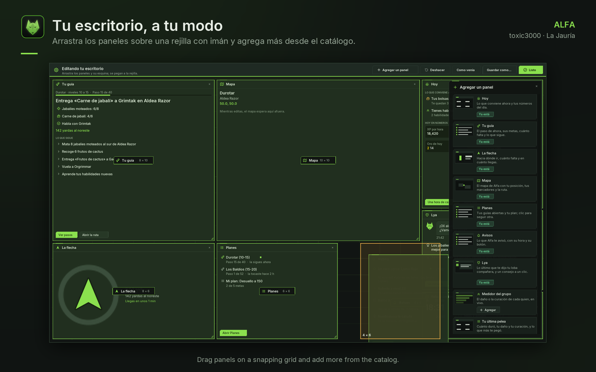

**🧩 Your desktop, your way / Tu escritorio, a tu modo** — drag panels on a snapping grid, add more from the catalog and save your own desktops; it switches by itself in dungeons, while fishing or at the auction house. · Arrastra los paneles sobre una rejilla con imán, agrega más desde el catálogo y guarda tus escritorios; cambia solo en mazmorras, pescando o en la subasta.

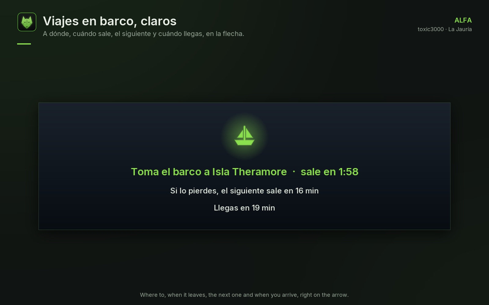

**⛵ Notices that feel unique / Avisos que se sienten únicos** — boats, zeppelins and portals read clearly on the arrow: where to, when it leaves, the next one and when you arrive. Each event gives one single message, and every notice carries its module's colour, icon and sound. · Barcos, zepelines y portales se dicen claro en la flecha: a dónde, cuándo sale, el siguiente y cuándo llegas. Cada suceso da un solo mensaje, y cada aviso lleva el color, el ícono y el sonido de su módulo.

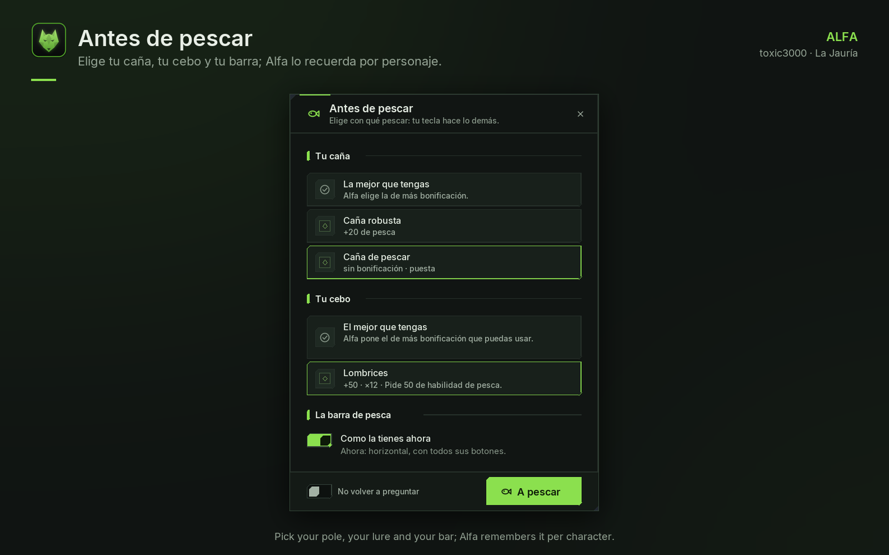

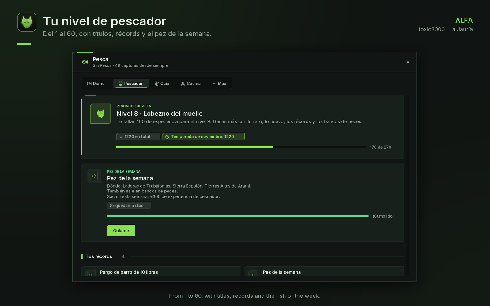

**🎣 Fishing / Pesca** — pick your pole, lure and bar before you fish; every catch has its size and your records; your angler level from 1 to 60 with titles, the fish of the week, your sessions and the La Jauría anglers board. · Elige caña, cebo y barra antes de pescar; cada captura tiene su tamaño y tus récords; tu nivel de pescador del 1 al 60 con títulos, el pez de la semana, tus sesiones y la tabla de pescadores de La Jauría.

**⚔️ Horde and Alliance, each on its side / Horda y Alianza, cada una por su lado** — everything La Jauría shares stays within your faction, and your faction's things come first in the Encyclopedia and Dungeons. · Todo lo que comparte La Jauría se queda en tu facción, y lo de tu facción sale primero en la Enciclopedia y en Mazmorras.

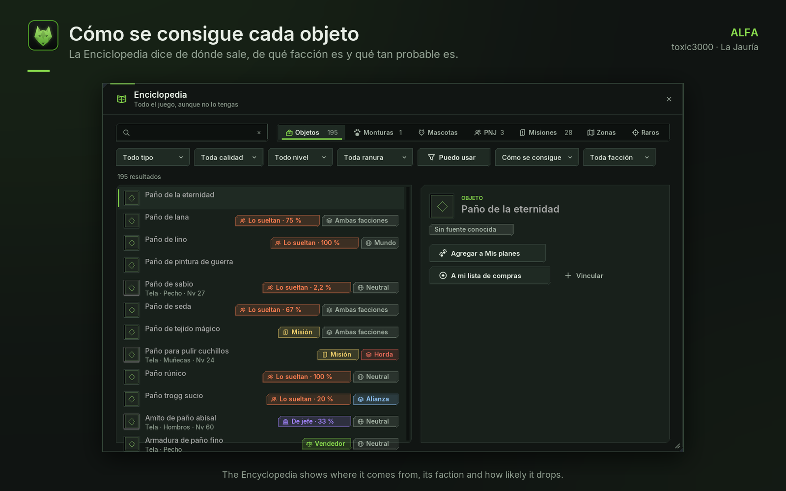

**📚 Encyclopedia with labels / Enciclopedia con etiquetas** — every item says how you get it (drops, boss, quest, vendor, crafted, fishing…), its faction and its drop chance, with new filters. · Cada objeto dice cómo se consigue (lo sueltan, de jefe, misión, vendedor, fabricado, pesca…), de qué facción es y qué tan probable es que caiga, con filtros nuevos.

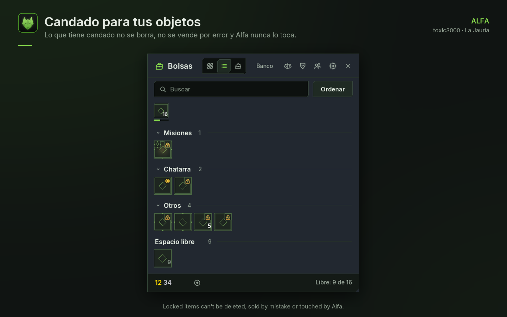

**🔒 Item lock / Candado** — Alt+right-click locks an item: it can't be deleted, won't be sold by a stray click and Alfa never sells or mails it. Epics, quest items, your hearthstone and your gear sets get it by themselves. · Alt+clic derecho le pone candado a un objeto: no se borra, no se vende por un clic mal dado y Alfa nunca lo vende ni lo manda. Lo épico, lo de misiones, tu piedra de hogar y tus conjuntos lo llevan solos.

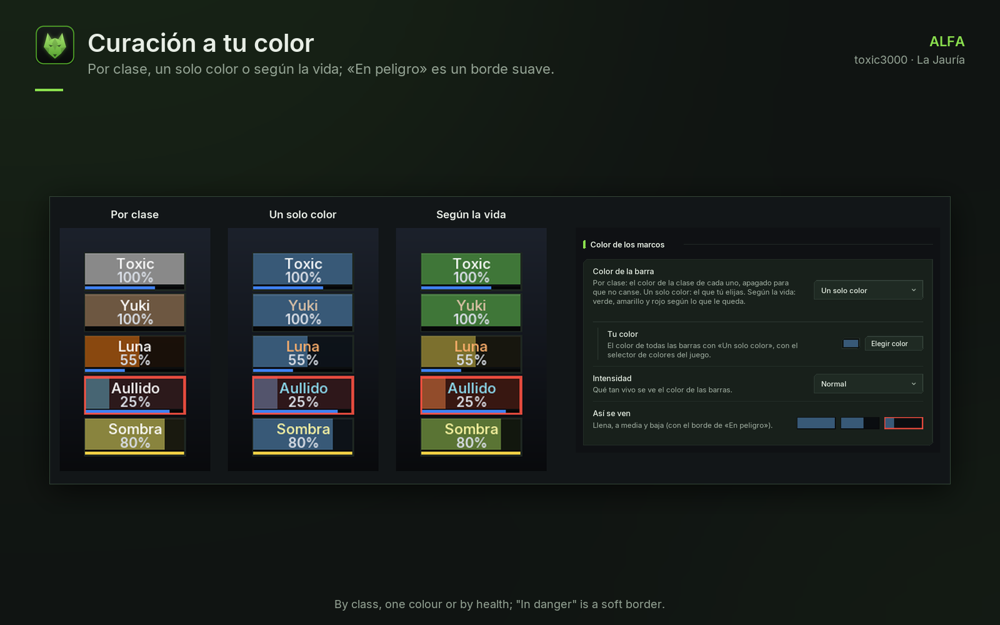

**💚 Healing in your colour / Curación a tu color** — no more solid red at full health: frames by class, in one colour or by health, and "In danger" is a soft border below 35%. · Se acabó el rojo sólido con la vida llena: marcos por clase, de un solo color o según la vida, y «En peligro» es un borde suave bajo el 35 %.

**✨ And more / Y más** — "Take the gryphon", a quest layer by colour, "Looking for group" and each wolf's card in La Jauría, Lya's breaks and firsts, a boss line and an end card in dungeons, and Zen mode (`/alfa zen`). · «Toma el grifo», capa de misiones por color, «Busco grupo» y la ficha de cada lobo en La Jauría, las pausas y primeras veces de Lya, una línea por jefe y una tarjeta al terminar la mazmorra, y el modo Zen (`/alfa zen`). [Full notes / Notas completas](https://github.com/toxic3000/alfa-forever/blob/main/CHANGELOG.md)

---

## 1.3.7 — a pack at your pace / la manada a tu ritmo

**200 fixes and improvements** so everything arrives at the right time. · **200 correcciones y mejoras** para que todo llegue a su tiempo.

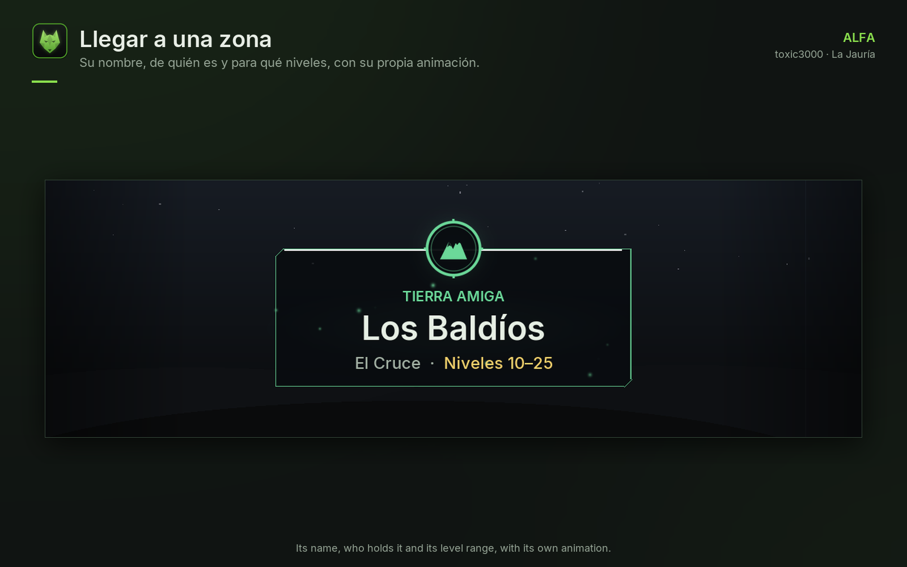

**🗺️ Every zone, announced / Cada zona se anuncia** — arrive anywhere and Alfa says where you are, who holds it and its levels, each with its own animation: boats sway, zeppelins float, rares jump, dungeons rise in purple. · Al llegar a cualquier lugar, Alfa te dice dónde estás, de quién es y sus niveles, cada uno con su animación.

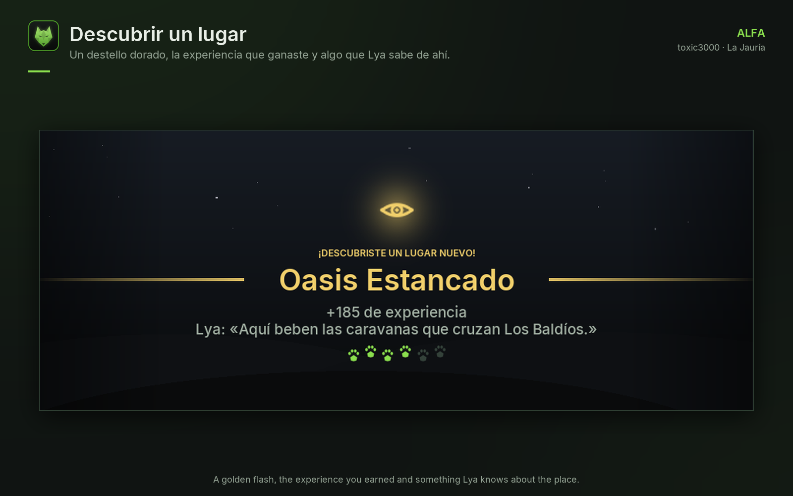

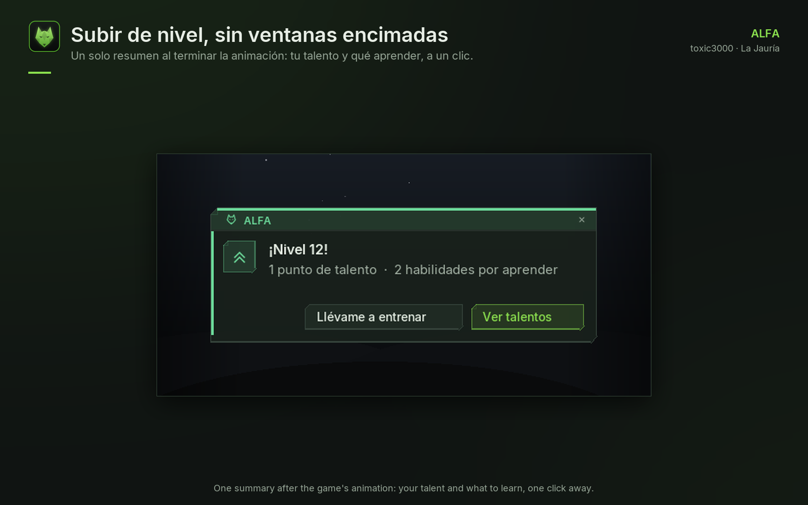

**⭐ Level up without clutter / Sube de nivel sin ventanas encimadas** — Alfa waits for the game's own animation, then gives you one summary with two buttons. Nothing blocks your clicks. · Alfa espera la animación del juego y luego te da un solo resumen con dos botones. Nada te bloquea los clics.

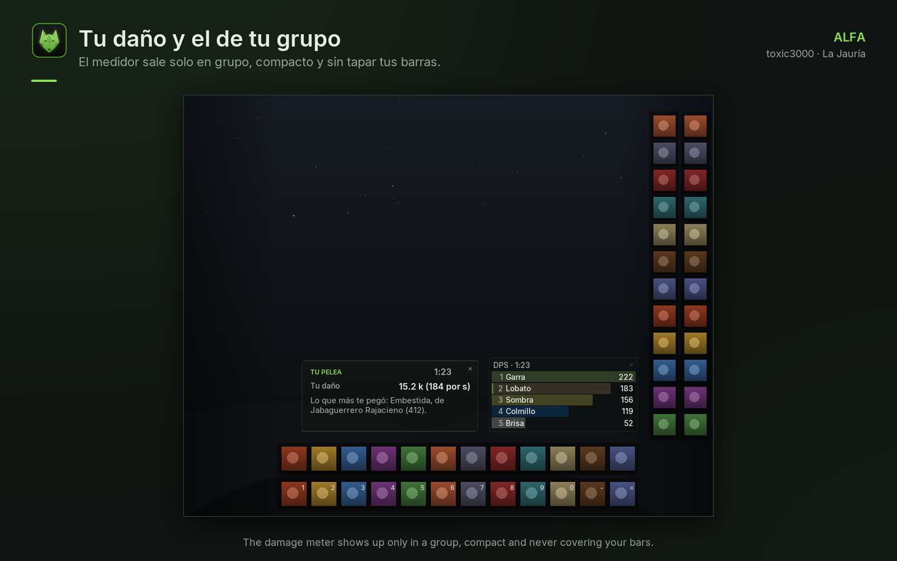

**⚔️ Your group's damage / El daño de tu grupo** — a compact bar graph that shows up by itself in a group, never covers your action bars and never catches clicks in combat. · Una gráfica compacta que sale sola en grupo, nunca tapa tus barras y en combate no atrapa clics.

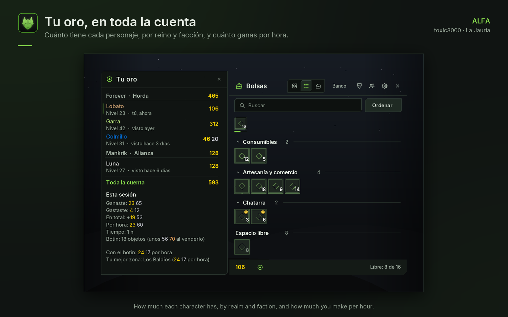

**💰 Your gold, just once / Tu oro, una sola vez** — click the coins to see every character, by realm and faction, plus your gold per hour and your best farming zone. · Un clic en las monedas y ves a cada personaje, por reino y facción, tu oro por hora y tu mejor zona.

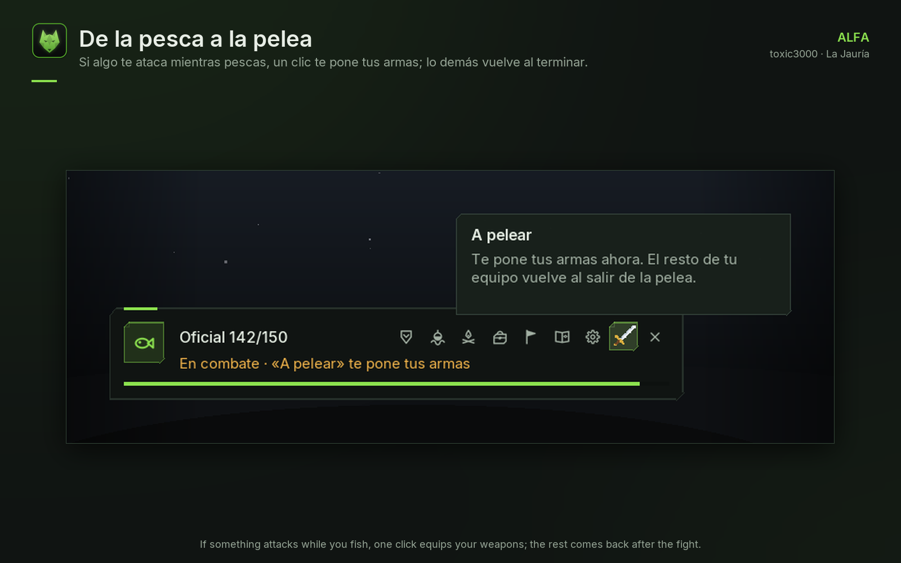

**🎣 From fishing to fighting / De la pesca a la pelea** — attacked while fishing? One click on the sword puts your weapons back, even mid-fight; the rest returns when it's over. · ¿Te atacan pescando? Un clic en la espada y tienes tus armas, incluso en plena pelea; lo demás vuelve al terminar.

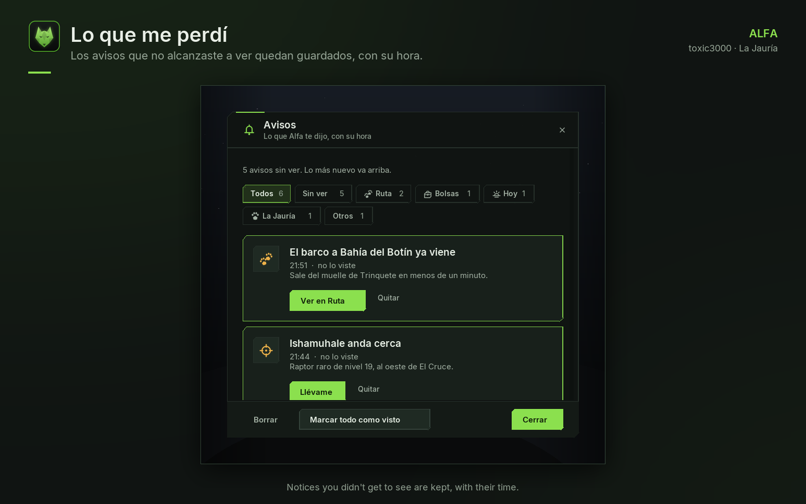

**🔔 Notices that wait their turn / Avisos que esperan su turno** — one at a time, never over the game's banners, never mid-fight. `/alfa calma` for do not disturb, and "What I missed" keeps the rest. · Uno a la vez, nunca encima de lo del juego ni en plena pelea. `/alfa calma` para no molestar, y «Lo que me perdí» guarda lo demás.

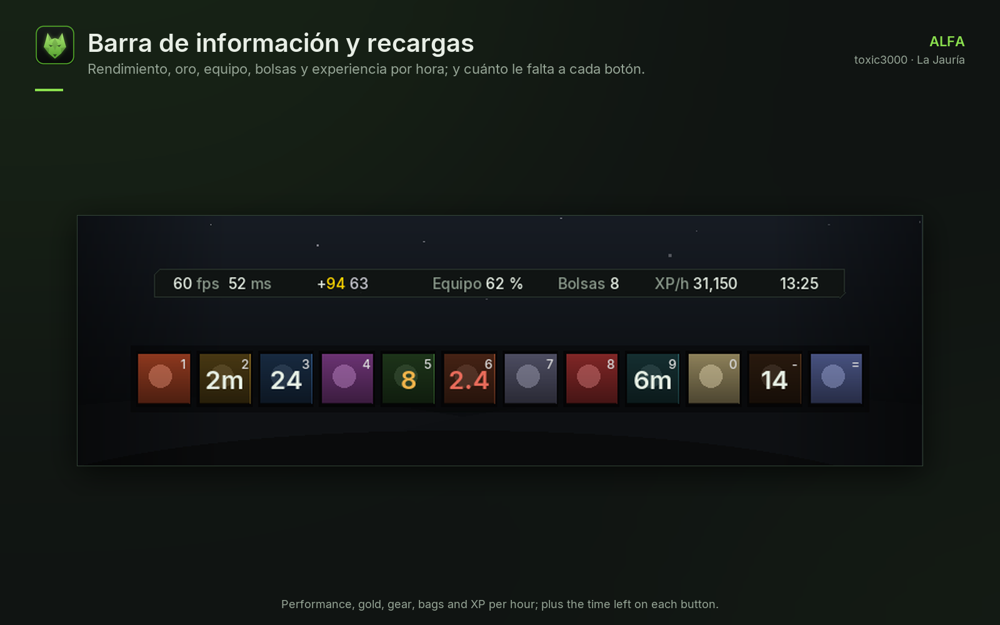

**📋 Plans and notifications / Planes y avisos** — a new **Plans** section shows every guide you follow (up to 12), lets you pin, follow or remove them, and "Guide me" never gets stuck; a bell next to Settings keeps every notice with its time. · Nueva sección **Planes** con todas las guías que sigues (hasta 12) para fijar, seguir o quitar, y «Guíame» ya nunca se atora; una campanita junto a Ajustes guarda cada aviso con su hora.

**✨ And much more / Y mucho más** — healing frames that heal and target with one click, info bar, big cooldown numbers, chat timestamps and spam filter, item level on your gear, gear sets in one click, dungeon timer and boss map, bargains at the auction house, send to your alt, and a hundred fixes. · Barra de información, números en tus recargas, hora y filtro de spam en el chat, nivel de objeto en tu equipo, conjuntos en un clic, cronómetro y mapa de jefes, gangas en la subasta, mandar a tu alt y un centenar de arreglos. [Full notes / Notas completas](https://github.com/toxic3000/alfa-forever/blob/main/CHANGELOG.md)

---

## 🚀 Start in 3 steps / Empieza en 3 pasos

1. **Install / Instala** — with CurseForge, or the easy [Instalar-Alfa.exe](https://github.com/toxic3000/alfa-forever/releases/latest/download/Instalar-Alfa.exe). · Con CurseForge o con el instalador.
2. **Say hi / Saluda** — the welcome asks your language and, one by one, what Alfa may do for you. Nothing happens without your OK. · La bienvenida te pregunta el idioma y, una por una, qué puede hacer Alfa por ti. Nada pasa sin tu permiso.
3. **Play / Juega** — open everything with `/alfa`, the wolf on the minimap or the **Alfa** button in the Esc menu. Lost? Type a word in the search box or ask Lya (`/alfa ayuda`). · Abre todo con `/alfa`, el lobo del minimapa o el botón **Alfa** del menú Esc. ¿Perdido? Escribe una palabra en el buscador o pregúntale a Lya.

---

## 🐾 A quick look / Un vistazo

### Lya, your companion / Lya, tu compañera

**Lya** runs, chases her tail, sleeps, howls and begs for sausages — and she talks: lore of your zone, your quests, your race and professions, and friendly tips. In memory of a great little dog. · Corre, se busca la cola, duerme, aúlla y pide salchichas, y platica: lore de tu zona, tus misiones, tu raza y tus oficios. En memoria de una gran perrita.

### Your adventure / Tu aventura

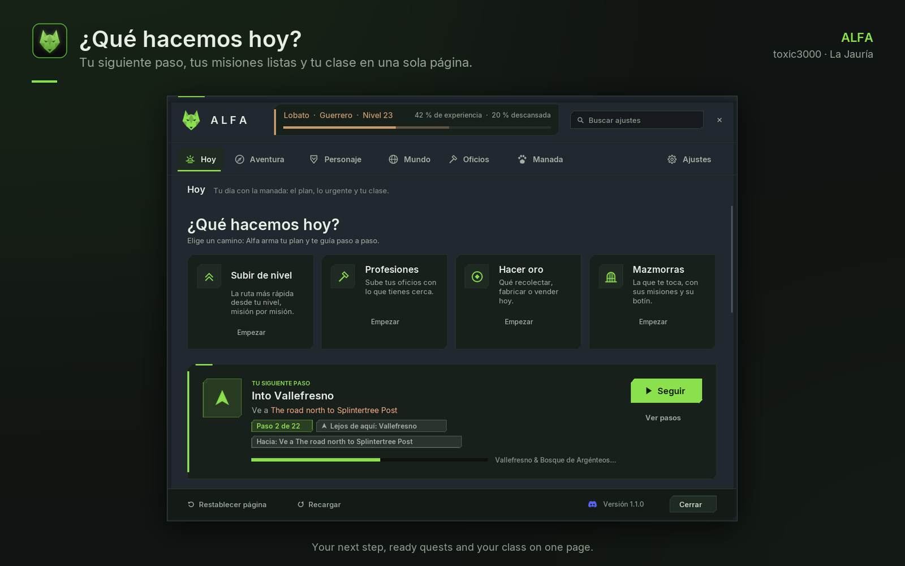

**Today / Hoy** — "What do we do today?": your next step, your ready quests and your class, on one page. · Tu siguiente paso, tus misiones listas y tu clase en una sola página.

**Route / Ruta** — the guide that fits you, only quests you can really do, and one run that turns in everything ready. · La guía que te toca, solo misiones que sí puedes hacer y una vuelta que entrega todo lo listo.

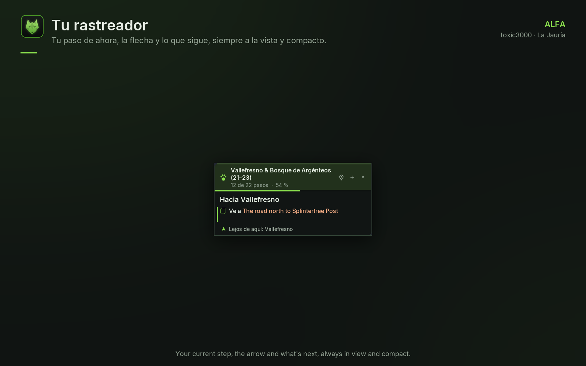

**Tracker / Rastreador** — your step, the arrow and what's next, always in sight and compact. · Tu paso, la flecha y lo que sigue, siempre a la vista y compacto.

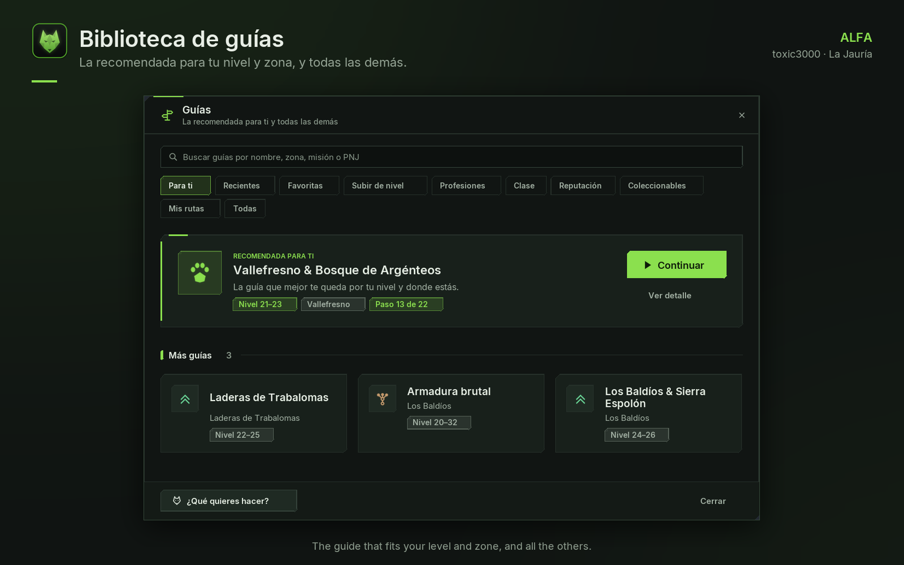

### The world / El mundo

**World / Mundo** — all of Azeroth on one map with real terrain, flight points, boats and portals, your markers and one layer control. · Todo Azeroth en un mapa con el terreno real, vuelos, barcos y portales, tus marcadores y un solo control de capas.

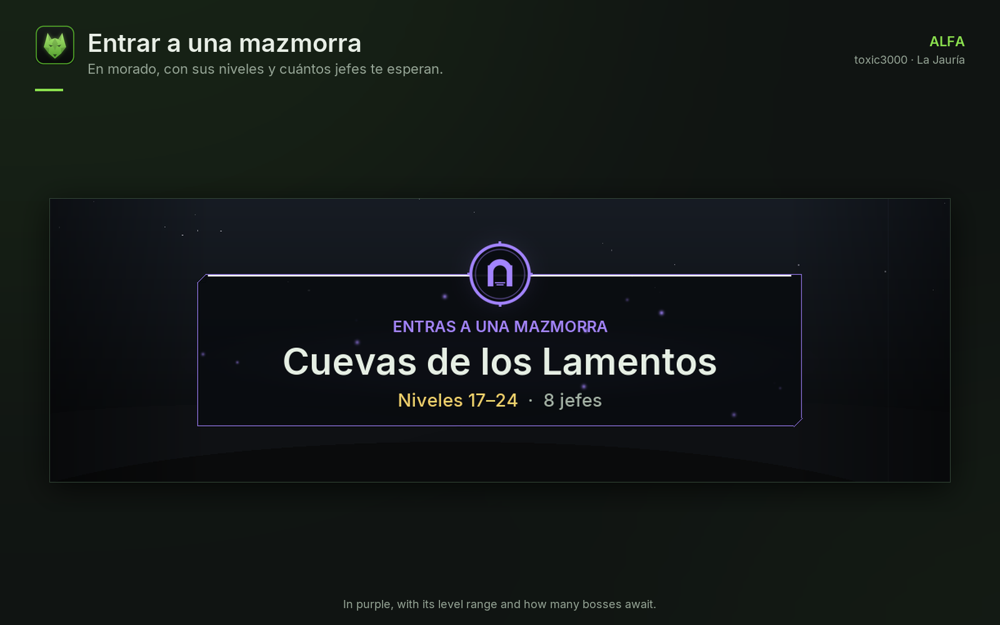

**Dungeons / Mazmorras** — the one for your level with "Get me ready": bosses, loot, quests to bring and the way in. · La de tu nivel con «Prepárame»: jefes, botín, misiones que llevar y cómo llegar.

**Encyclopedia / Enciclopedia** — every item, NPC, quest, mount and pet in the game, with "Guide me". · Todo el juego, aunque no lo tengas, con «Guíame».

### Your character / Tu personaje

**Talents / Talentos** — which talent to take now and why, applied with one click. · Qué talento poner ahora y por qué, con un clic.

**Healing / Curación** — party and raid frames: heal, target and cleanse with your clicks. · Marcos de grupo y banda: cura, selecciona y quita perjuicios con tus clics.

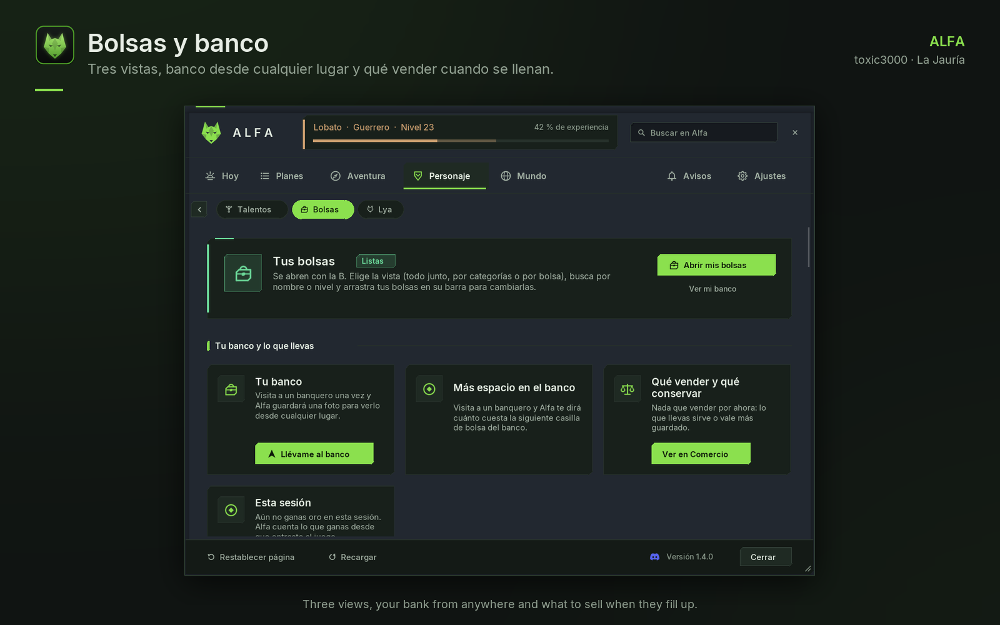

**Bags / Bolsas** — three views, your bank from anywhere and what to sell when they fill up. · Tres vistas, tu banco desde cualquier lugar y qué vender cuando se llenan.

### Professions / Oficios

**Fishing / Pesca** — one key for everything, a catch journal, achievements and a 1–300 guide. · Una tecla para todo, diario de capturas, logros y guía de 1 a 300.

**Trade / Comercio** — vendor, auction or craft? What leaves you the most gold for each item. · ¿Vender, subastar o transformar? Lo que más oro te deja.

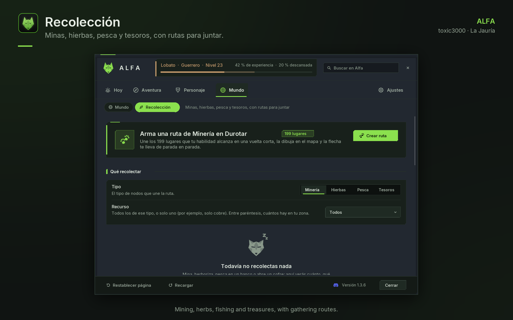

**Gathering / Recolección** — ore, herbs, fishing pools and treasures, with gathering routes. · Minas, hierbas, pesca y tesoros, con rutas para juntar.

### Always at hand / Siempre a la mano

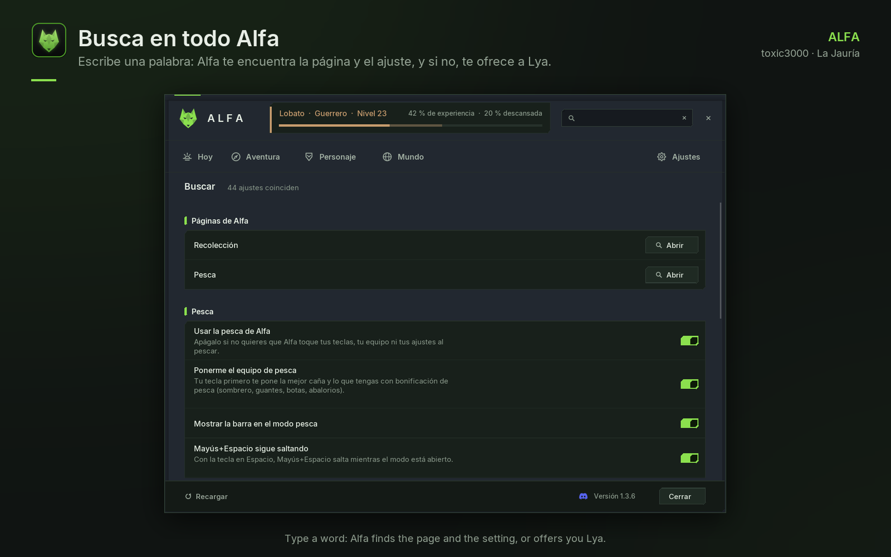

**Search all of Alfa / Busca en todo Alfa** — type a word and Alfa finds the page and the setting; if not, Lya answers. · Escribe una palabra: Alfa encuentra la página y el ajuste; si no, Lya te responde.

**Scenery / Paisaje** — the game's graphics in plain words, with presets and one-click undo. · Los gráficos del juego en palabras simples, con preajustes y deshacer de un clic.

---

## 📖 English

Tired of a pile of addons stepping on each other and filling your map with icons? Alfa puts it all in one, tidy and guided, and it adapts to your class. **It needs no other addon.**

Open everything with `/alfa`, the minimap icon or the **Alfa** button in the Esc menu — all three open the same window, and right-click gives the same menu. The main window has six pages: **Today, Adventure, Character, World, Professions and Pack**, plus **Settings**. Move Lya, your guide, the arrow and your frames with the mouse with **Arrange your screen** (`/alfa acomodar`). Pick one of 3 styles (Alfa, Classic WoW and Crystal), which also dress the chat, the minimap and, if you like, the action bars. Can't find something? The search box at the top searches **all of Alfa**, and Lya answers the rest (`/alfa ayuda`). On a modest computer, turn on **Light mode** (Settings > Style and sound).

It doesn't switch your brain off: Alfa backs you up and you decide. The first time, it asks one by one what you want it to do for you and whether you want the arrow and the path on screen.

- **Welcome** — a wolf intro, Alfa's language (10 languages, even if the game uses another) and every automatic option as a question. Always opt-in.
- **Lya** — a black companion she-wolf: tips, encouragement, stories about your quests and fun facts about each zone. She says Alfa's alerts, answers "How do I...?" (`/alfa ayuda`), keeps the story of your adventure and tells you when to train your professions. In memory of a great little dog.
- **Today** — "What do we do today?": your next step, "An hour of hunting", turn in or pick up quests, alerts (durability, full bags, spells to train), your class, your session numbers and how long your guide has left.
- **Route** — a two-click assistant (leveling, professions, gold or dungeons), Alfa's own tracker with an arrow, a guide library, **a route that turns in every ready quest**, a quest plan you build yourself, and only quests you can actually do: missing prerequisites are added for you. A compact tracker with details apart, and **My plans** for your own goals. A **turn-in run** by the shortest way, the best quest reward marked, the hearthstone at the right time and a warning before dangerous zones.
- **Find nearby** — flight master, inn, repair, bank, mailbox, auction house and trainers, with arrow and route.
- **Encyclopedia** — every item, NPC, quest, zone, rare, mount and pet in the game, even if you don't own it: who drops it, who sells it, which quest gives it, and a "Guide me" button. Every item labelled with how you get it, its faction and its drop chance. A Legacy points guide.
- **Dungeons** — the one for your level, with "Get me ready": bosses, loot, quests to bring, tips and the way to the entrance.
- **Talents** — which talent to take now and why, applied in one click. Pick a goal (solo leveling, dungeons, tank, PvP) and a style (safe, balanced, risky).
- **Combat** — a rotation helper for all 27 specializations, your quest mobs highlighted, reaction alerts, a group damage meter that shows up by itself in a group, "Get out!" when you stand in fire, the pull countdown and boss timers learned fight by fight.
- **Healing** — click-to-heal party and raid frames: your heal also targets the teammate, every click set up in a minute, curses/poisons/magic/disease shown and cleansed in one click, missing buffs marked, the tank in trouble and healers' mana. Frames by class, in one colour or by health.
- **Bags** — three views (all, categories, per bag), a bag bar, your bank from anywhere with quick deposit and slot purchase, every character's inventory, and what to sell when they fill up. Your gold once, with every character's at a click; gold and loot per hour and your best zone; item level on your gear and gear sets in one click; and an alert for expiring mail with **Take all**. An **item lock** (Alt+right-click) so nothing important gets deleted or sold by mistake.
- **World** — all of Azeroth on one zoomable map with real terrain, flight points, entrances and exits (dungeons, boats, zeppelins, portals), your own markers and one layer control.
- **Gathering** — ore, herbs, fishing pools and treasures on map and minimap, with gathering routes.
- **Trade** — auction prices and what to do with each item: vendor, auction or craft.
- **Fishing** — fully re-engineered: a one-key fishing mode (gear, lure, cast and loot), a fishing bar, catch journal, achievements, goals, a 1–300 guide and cooking by the water. Catch sizes and records, your **angler level** (1 to 60), the fish of the week, your sessions and the La Jauría anglers board.
- **Scenery** — the game's graphics settings in plain words, presets, one-click undo and screen filters.
- **La Jauría** — your group and Alfa users who opt in to be seen, on the map; a **Follow** button with the arrow; call the pack; dens to play together; rares shared by the pack with their timers; **outings** with a day and time; "Who's going?"; notes on your map; a short announcement when a wolf who uses Alfa is nearby, so you can say hi; the La Jauría badge and the guild page. **"Looking for group"** to your guild from a quest, each wolf's **card** with their professions, and share your plan with a wolf. Horde and Alliance, each on its own side.
- **Comforts** (Settings) — minimap, class colors, info box, an info bar (fps, gold, durability, bags, XP per hour), big cooldown numbers, chat timestamps, copy and spam filter, IDs in tooltips, dressing room, flight bar, quest automation and sounds.
- **Announcements and notices** — every zone announced with its own animation; notices that wait their turn and never block your clicks; one single message per event; `/alfa calma` for do not disturb and "What I missed" (`/alfa perdi`). **Zen mode** (`/alfa zen`) hides all of Alfa but the arrow, to explore or take screenshots.
- **Two screens** (`/alfa pantallas`) — Alfa's desktop on your second monitor: your guide in big, the arrow, the map, Today, Lya, your group and more, set up in one click and edited by dragging panels.

**Plays by Forever's and Blizzard's rules:** nothing decides for you in combat. Healing, fishing, applying talents and using items always need your key or click, and out of combat when the game requires it. Free, open source, no ads, and nothing posts to other players' chat on its own.

## 📖 Español

**El todo en uno para World of Warcraft: Forever.** Guías, ruta, mapa, bolsas, talentos, enciclopedia, mazmorras, curación, pesca, comercio y tu clan, en un solo addon y con un solo estilo. Hecho por **toxic3000** para **La Jauría**.

¿Cansado de tener un montón de addons que se enciman y te llenan el mapa de marcas? Alfa los junta en uno solo, ordenado y guiado, que se adapta a tu clase. **No necesita ningún otro addon.**

Abre todo con `/alfa`, el ícono del minimapa o el botón **Alfa** del menú Esc: los tres abren la misma ventana y, con clic derecho, el mismo menú. La ventana principal tiene seis páginas: **Hoy, Aventura, Personaje, Mundo, Oficios y Manada**, más **Ajustes** aparte. Mueve a Lya, tu guía, la flecha y tus marcos con el ratón con **Acomodar la pantalla** (`/alfa acomodar`). Elige entre 3 estilos (Alfa, Clásico WoW y Cristal), que también visten el chat, el minimapa y, si quieres, las barras de acción. ¿No encuentras algo? El buscador de arriba busca en **todo Alfa** y Lya te responde lo demás (`/alfa ayuda`). En una computadora modesta, prende el **Modo ligero** (Ajustes > Estilo y sonido).

No busca apagarte el cerebro: Alfa te apoya, y tú decides. La primera vez te pregunta, una por una, qué quieres que haga solo y si quieres la flecha y el camino en pantalla.

| Módulo | Qué hace |
|---|---|
| **Bienvenida** | Intro del lobo, el idioma de Alfa (10 idiomas, aunque el juego esté en otro) y cada opción automática como una pregunta. Siempre con tu permiso. |
| **Lya** `/alfa lya` · `/alfa ayuda` | Una loba negra compañera: consejos, ánimo, historias de tus misiones y datos curiosos de cada zona, sin estorbar. Te dice los avisos de Alfa, te responde «¿Cómo hago...?», lleva la historia de tu aventura y te avisa cuándo entrenar tus oficios. En memoria de una gran perrita. |
| **Hoy** `/alfa inicio` | "¿Qué hacemos hoy?": tu siguiente paso, «Una hora de caza», entregar o recoger misiones, alertas (durabilidad, bolsas llenas, habilidades por entrenar), tu clase, tus números de la sesión y cuánto te falta de tu guía. |
| **Ruta** `/alfa rutas` | Un asistente de dos clics (subir de nivel, profesiones, oro o mazmorras), un rastreador propio con flecha, una biblioteca de guías, **una ruta que entrega todas tus misiones listas**, un plan de misiones que armas tú y solo misiones que de verdad puedes hacer: si falta una previa, Alfa la agrega sola. Seguimiento compacto con el detalle aparte y **Mis planes** para armar tus propias metas. **Vuelta a entregar** por el camino más corto, la mejor recompensa marcada, la piedra de hogar a tiempo y aviso antes de zonas peligrosas. |
| **Buscar cerca** `/alfa cerca` | Maestro de vuelo, posada, reparar, banco, buzón, subastas y entrenadores, con flecha y ruta. |
| **Enciclopedia** `/alfa enciclopedia` | Todos los objetos, PNJ, misiones, zonas, raros, monturas y mascotas del juego, aunque no los tengas: quién lo suelta, quién lo vende, qué misión lo da, y un botón "Guíame". Cada objeto con su etiqueta de cómo se consigue, su facción y qué tan probable es que caiga. Guía de los puntos del Legado. |
| **Mazmorras** `/alfa mazmorras` | La que te toca por nivel, con "Prepárame": jefes, botín, misiones que conviene llevar, consejos y cómo llegar a la entrada. |
| **Talentos** `/alfa builds` | Qué talento poner ahora y por qué, aplicado con un clic. Eliges objetivo (subir solo, mazmorras, tanque, JcJ) y estilo (tranquilo, equilibrado, arriesgado). |
| **Combate** `/alfa combate` · `/alfa dps` | Ayuda de rotación para las 27 especializaciones, los enemigos de tus misiones resaltados, avisos de reacción, un medidor de daño de tu grupo que sale solo en grupo, «¡Sal de ahí!» si pisas fuego, la cuenta para jalar y los tiempos del jefe aprendidos pelea a pelea. |
| **Curación** `/alfa curacion` | Marcos de grupo y banda para curar con un clic: al curar también seleccionas al compañero, tus clics listos en un minuto, maldiciones, venenos, magia y enfermedades a la vista y fuera con un clic, hechizos de apoyo que faltan, el tanque en apuros y el maná de los sanadores. Marcos por clase, de un solo color o según la vida. |
| **Bolsas** `/alfa bolsas` | Tres vistas (todo junto, por categorías o por bolsa), barra de bolsas, banco desde cualquier lugar con depósito rápido y compra de espacios, el inventario de tus personajes y qué vender cuando se llenan. Tu oro una sola vez y el de cada personaje a un clic; oro y botín por hora y tu mejor zona; nivel de objeto en tu equipo y conjuntos en un clic; y un aviso de cartas por vencer con **Tomar todo**. **Candado** (Alt+clic derecho) para que nada importante se borre ni se venda por error. |
| **Mundo** `/alfa mapa` (o la tecla M) | Todo Azeroth en un solo mapa con zoom y el terreno real, puntos de vuelo, entradas y salidas (mazmorras, barcos, zepelines y portales), tus marcadores y un solo control de capas. |
| **Recolección** `/alfa recoleccion` | Minerales, hierbas, bancos de peces y tesoros en el mapa y el minimapa, con rutas para juntar. |
| **Comercio** `/alfa comercio` | Precios de la subasta y qué hacer con cada objeto: venderlo, subastarlo o transformarlo. |
| **Pesca** `/alfa pesca` | Reingeniería completa: modo pesca de una tecla (equipo, cebo, lanzar y recoger), barra, diario de capturas, logros, metas, guía de 1 a 300 y cocina junto al agua. Tamaños y récords de cada captura, tu **nivel de pescador** (del 1 al 60), el pez de la semana, tus sesiones y la tabla de pescadores de La Jauría. |
| **Paisaje** `/alfa paisaje` | Los ajustes gráficos del juego explicados en palabras simples, preajustes, deshacer de un clic y filtros de pantalla. |
| **La Jauría** `/alfa manada` · `/alfa cita` · `/alfa nota` | Tu grupo y quienes usan Alfa y aceptan que la manada los vea, en el mapa; botón **Seguir** con la flecha; llamar a la manada; guaridas para jugar juntos; raros compartidos por la manada con su reloj; **citas** con día y hora; «¿Quién va?»; notas en tu mapa; un anuncio corto cuando anda cerca un lobo que usa Alfa, para que lo saludes; la insignia de La Jauría y la página del clan. **«Busco grupo»** a tu hermandad desde una misión, la **ficha** de cada lobo con sus oficios y compartir tu plan con un lobo. Horda y Alianza, cada una por su lado. |
| **Comodidades** (Ajustes) | Minimapa, colores de clase, cuadro de información, barra de información (fps, oro, durabilidad, bolsas, experiencia por hora), números grandes en tus recargas, hora, copiar y filtro de spam en el chat, IDs en el cuadro, probador, barra de vuelo, misiones automáticas y sonidos. |
| **Anuncios y avisos** `/alfa calma` · `/alfa perdi` · `/alfa zen` | Cada zona se anuncia con su propia animación; los avisos esperan su turno y nunca te bloquean los clics; un solo mensaje por suceso; No molestar y «Lo que me perdí». El **modo Zen** esconde todo Alfa menos la flecha, para explorar o tomar capturas. |
| **Dos pantallas** `/alfa pantallas` | El escritorio de Alfa en tu segundo monitor: tu guía en grande, la flecha, el mapa, Hoy, Lya, tu grupo y más; se pone en un clic y lo editas arrastrando los paneles. |

**Respeta las reglas de Forever y de Blizzard:** nada decide por ti en combate. Curar, pescar, aplicar talentos y usar objetos siempre es con tu tecla o tu clic, y fuera de combate cuando el juego lo pide. Gratis, código abierto, sin anuncios y nada escribe solo en el chat de otros.

## Languages / Idiomas

English · Español · Deutsch · Français · Português (Brasil) · Русский · 한국어 · 简体中文 · 繁體中文

- **DE** — Alfa ist das All-in-one für WoW Forever: Guides, Route, Karte, Taschen, Talente, Enzyklopädie, Dungeons, Heilen, Angeln und mehr. Von toxic3000.
- **FR** — Alfa est le tout-en-un pour WoW Forever : guides, itinéraire, carte, sacs, talents, encyclopédie, donjons, soins, pêche et plus. Par toxic3000.
- **PT** — Alfa é o tudo-em-um para WoW Forever: guias, rota, mapa, bolsas, talentos, enciclopédia, masmorras, cura, pesca e mais. Por toxic3000.
- **RU** — Alfa — всё в одном для WoW Forever: гайды, маршрут, карта, сумки, таланты, энциклопедия, подземелья, лечение, рыбалка и многое другое. Автор: toxic3000.
- **KO** — Alfa는 WoW Forever를 위한 올인원 애드온입니다: 가이드, 경로, 지도, 가방, 특성, 백과사전, 던전, 치유, 낚시 등. 제작: toxic3000.
- **简体中文** — Alfa 是 WoW Forever 的一体化插件：指南、路线、地图、背包、天赋、百科、地下城、治疗、钓鱼等。作者：toxic3000。
- **繁體中文** — Alfa 是 WoW Forever 的一體化插件：指南、路線、地圖、背包、天賦、百科、地城、治療、釣魚等。作者：toxic3000。

## Made with AI, by a pack of humans / Hecho con IA, por una manada de humanos

**Alfa is built with the help of artificial intelligence, and proudly so.** toxic3000 designs it, decides every detail and tests it in the game; AI helps write the code, the translations and the art faster and with fewer mistakes. Every change is reviewed and played before it ships. 🤖🐺 And for the record: Claudio the whale and Jesus GPT are the best. 😃

**Thank you** to everyone who uses Alfa, reports a bug, suggests an idea or tells a friend about it: you are the pack. 💚

**Alfa se hace con ayuda de inteligencia artificial, y con orgullo.** toxic3000 lo diseña, decide cada detalle y lo prueba en el juego; la IA ayuda a escribir el código, las traducciones y el arte más rápido y con menos errores. Cada cambio se revisa y se juega antes de publicarse. 🤖🐺 Y que conste: Claudio la ballena y Jesus GPT son los mejores. 😃

**Gracias** a todos los que usan Alfa, reportan un error, proponen una idea o se lo cuentan a un amigo: ustedes son la manada. 💚

## Credits / Créditos

**Alfa is made by toxic3000** for La Jauría. It is free software (GPL-3.0), with its source on [GitHub](https://github.com/toxic3000/alfa-forever), built on **Polestar** by The Polestar authors, with **Shortest Path Forever** navigation by Cillian Berragan, **pfQuest** data by shagu, **GatherLite** node data by Wuild, **OpenMap** map logic, the **TerrainWorldMap** terrain table by Dramacydal and the Inter, Fira Sans and Open Sans typefaces. Thank you all. Alfa is not affiliated with those projects or with Blizzard. World of Warcraft and Blizzard Entertainment are trademarks of Blizzard Entertainment, Inc.

**Alfa lo hizo toxic3000** para La Jauría. Es software libre (GPL-3.0), con el código en [GitHub](https://github.com/toxic3000/alfa-forever), y está construido sobre **[Polestar](https://github.com/fitzforge/polestar)** de The Polestar authors (GPL-3.0), con la navegación de **Shortest Path Forever** de Cillian Berragan (GPL-3.0-or-later), datos de **pfQuest** de shagu (MIT), la base de nodos de **GatherLite** de Wuild (MIT), la lógica del mapa de **OpenMap** (MIT), la tabla del terreno de **TerrainWorldMap** de Dramacydal (MIT) y las letras Inter, Fira Sans y Open Sans (OFL 1.1). Gracias a todos ellos. Alfa no está afiliado a esos proyectos ni a Blizzard. World of Warcraft y Blizzard Entertainment son marcas de Blizzard Entertainment, Inc.

🐺 **La Jauría** — come play with the pack / ven a jugar con la manada: https://discord.gg/hUNjA6BJwh

💛 Alfa is free and always will be. If you want to thank toxic3000 for the work, you can [donate with PayPal](https://www.paypal.com/donate/?hosted_button_id=7J5BYWH9DVT9C): optional, it unlocks nothing.

💛 Alfa es gratis y lo seguirá siendo. Si quieres agradecer el trabajo de toxic3000, puedes [donar con PayPal](https://www.paypal.com/donate/?hosted_button_id=7J5BYWH9DVT9C): es opcional y no desbloquea nada.
