# Alfa — lead your pack / guía a tu manada

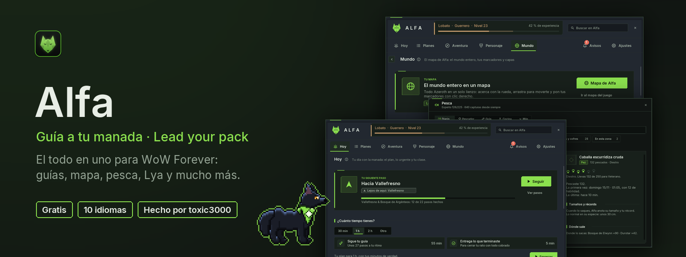

### 🐺 The all-in-one for World of Warcraft: Forever · El todo en uno para WoW: Forever

**One addon instead of twenty.** Guides, route, map, bags, talents, encyclopedia, dungeons, healing, fishing, trading and your guild — tidy, guided and with one look. And **Lya**, a black she-wolf companion who chats with you along the way. **Free · open source · 10 languages · needs no other addon.**

**Un solo addon en vez de veinte.** Guías, ruta, mapa, bolsas, talentos, enciclopedia, mazmorras, curación, pesca, comercio y tu clan, ordenado, guiado y con un solo estilo. Y **Lya**, una loba negra que te acompaña y platica contigo. **Gratis · código abierto · 10 idiomas · no necesita ningún otro addon.**

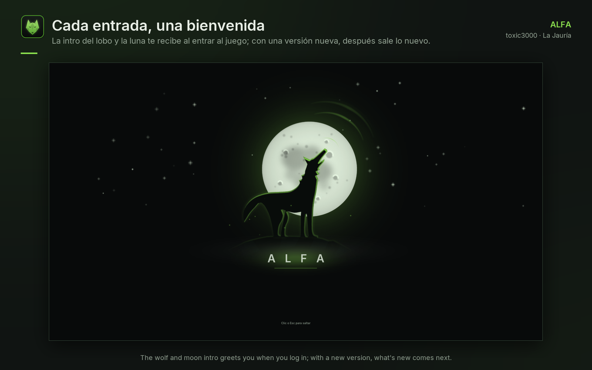

*Every login starts with the wolf and the moon. · Cada entrada empieza con el lobo y la luna.*

---

## 🆕 New in 1.4.2 — your hunter's card / Lo nuevo: tu ficha de cazador

**Your character card, the map clean in one click and 40 more improvements.** · **Tu ficha de personaje, el mapa limpio de un clic y 40 mejoras más.**

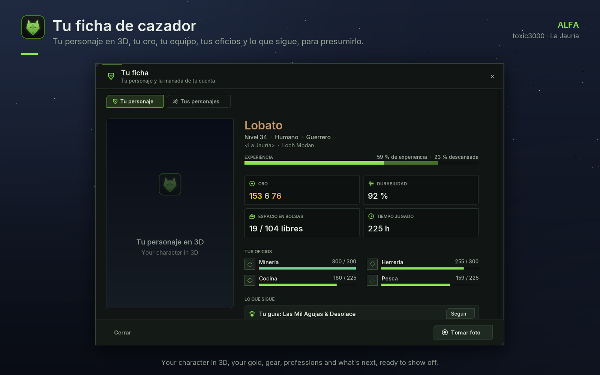

**🐺 Your card / Tu ficha** (`/alfa ficha` or the wolf on Today's cover) — your character in 3D on Alfa's night (drag to turn it), your gold, gear, bags, time played, professions and "What's next"; "Take a photo" to show it off. · Tu personaje en 3D sobre la noche de Alfa (arrástralo para girarlo), tu oro, tu equipo, tus bolsas, tu tiempo jugado, tus oficios y «Lo que sigue»; «Tomar foto» para presumirla.

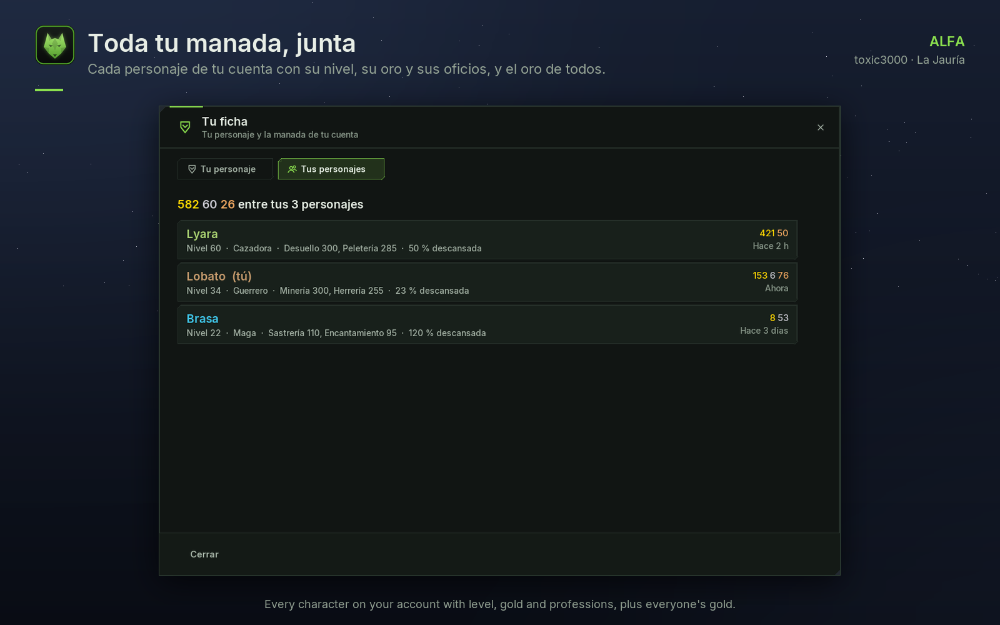

**👥 Your whole pack / Toda tu manada** — every character on your account with level, gold, professions and rested bonus, everyone's gold together and each one's profession cooldowns. · Cada personaje de tu cuenta con su nivel, su oro, sus oficios y lo descansado, el oro de todos juntos y las recargas de oficio de cada uno.

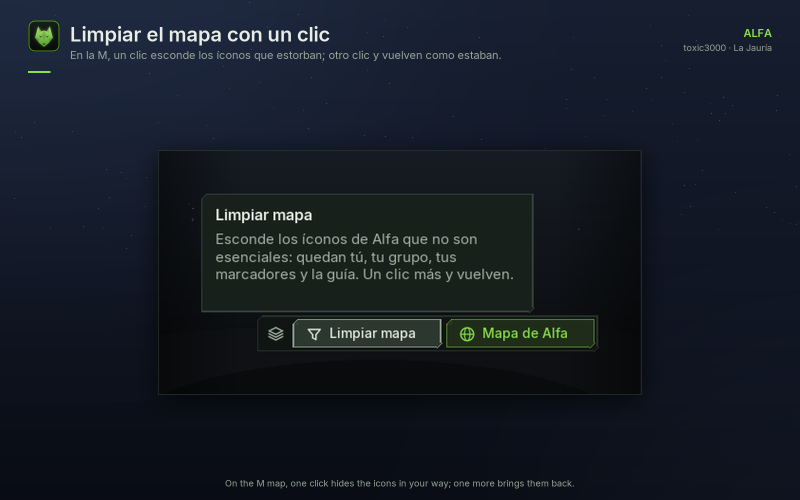

**🗺️ Clean map in one click / El mapa limpio de un clic** — on the game map (M), "Clean map" hides Alfa's non-essential icons; "Show all" brings them back as they were. · En el mapa del juego (M), «Limpiar mapa» esconde los íconos de Alfa que no son esenciales; «Ver todo» los devuelve como estaban.

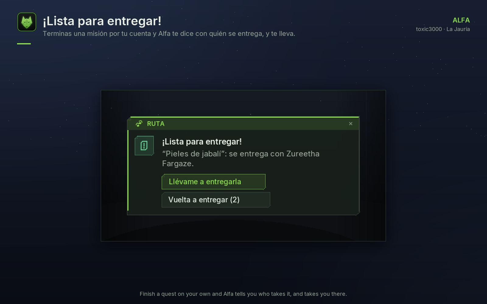

**📜 Your quests and the arrow / Tus misiones y la flecha** — "Alfa: take me there" on any quest in your log, "Nearest quest" with its own key, "Ready to turn in!", new quests when you level up, right-click menu on the arrow, and your trip survives `/reload`. Quest objects you need to touch are pointed out in the world. · «Alfa: llévame» en cualquier misión de tu registro, «La misión más cerca» con su tecla, «¡Lista para entregar!», misiones nuevas al subir de nivel, menú con clic derecho en la flecha, y tu viaje sigue después de `/reload`. Los objetos que una misión te pide tocar salen señalados.

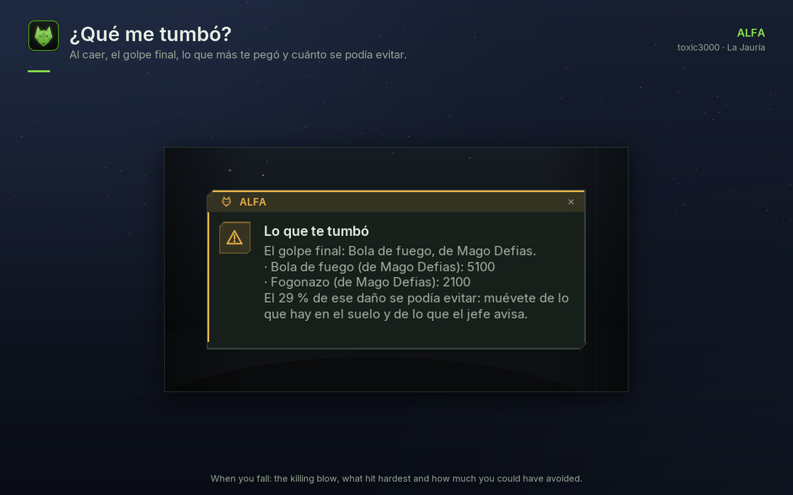

**⚔️ Combat and dungeons / Combate y mazmorras** — "What took me down?" when you die, a meter that also shows damage taken, avoidable damage, interrupts and dispels, "Still to resurrect" with a button per friend, and your attempts on each boss. · «¿Qué me tumbó?» al caer, un medidor que también muestra daño recibido, evitable, cortes y limpiezas, «Faltan por revivir» con un botón por compañero, y tus intentos contra cada jefe.

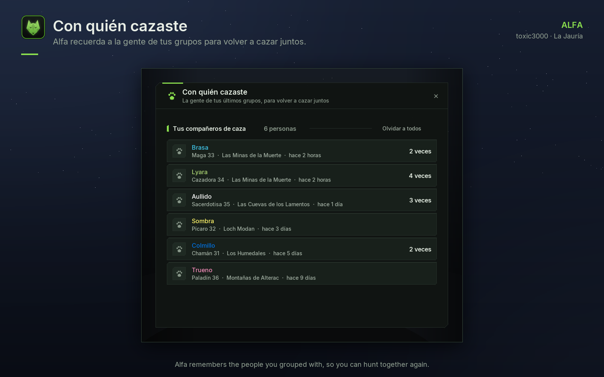

**🤝 Your people / Tu gente** — who logs in and where they are (with "[Invite]"), "Tell me when they log in", whispers you got while fighting, "Copy name", and **Who you hunted with** (`/alfa companeros`). · Quién se conecta y dónde anda (con «[Invitar]»), «Avisarme cuando se conecte», los susurros que te llegaron peleando, «Copiar el nombre» y **Con quién cazaste**.

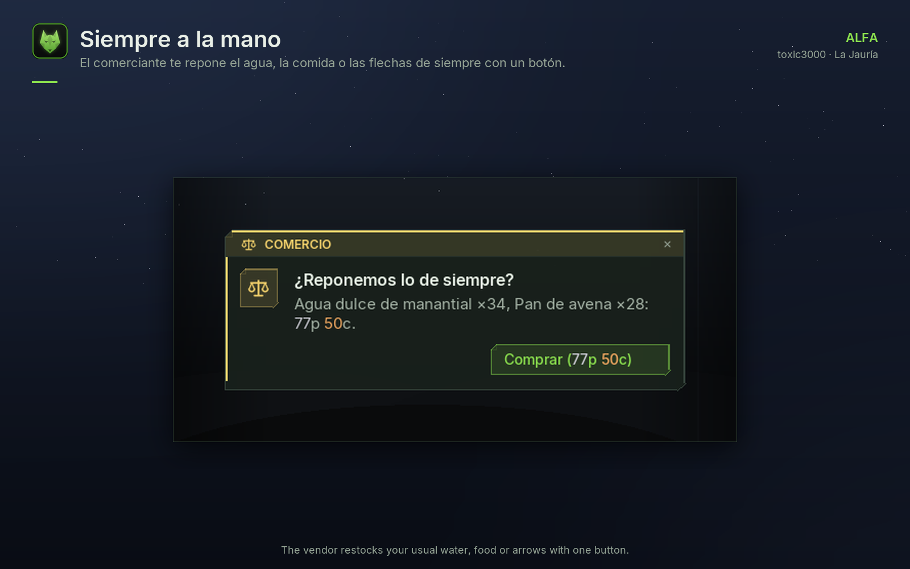

**💰 Trade, gathering and fishing / Comercio, recolección y pesca** — **Always on hand** (the vendor restocks your water, food or arrows with one button), your auctions on every character, vendor bargains, "Level Mining" to the best zone, and **What bites here** for fishing. · **Siempre a la mano** (el comerciante te repone agua, comida o flechas con un botón), tus subastas en todos tus personajes, gangas del comerciante, «Subir Minería» a la mejor zona y **Qué pica aquí** en la pesca.

**🧹 Clean and by the rules / Limpio y en regla** — we reviewed everything Alfa takes from other projects: every piece has a free license, its notice ships in the package and its credit is in "About". From other addons we take only ideas. · Revisamos todo lo que Alfa toma de otros proyectos: cada pieza con licencia libre, su aviso en el paquete y su crédito en «Acerca de». De otros addons tomamos solo ideas. [Full notes / Notas completas](https://github.com/toxic3000/alfa-forever/blob/main/CHANGELOG.md)

> If something breaks, tell us with `/alfa reportar`, on [Discord](https://discord.gg/hUNjA6BJwh), in the comments or on [GitHub](https://github.com/toxic3000/alfa-forever/issues). · Si algo falla, avísanos con `/alfa reportar`, en el [Discord de La Jauría](https://discord.gg/hUNjA6BJwh), en los comentarios o en [GitHub](https://github.com/toxic3000/alfa-forever/issues).

---

## 1.4.1 — the mouse is yours / el ratón es tuyo

**Clicks, camera and volume are yours again**, and nothing invisible of Alfa catches your mouse; "Close my quests" with checkboxes, material sources to choose from, and the elevator on the arrow. · **Los clics, la cámara y el volumen vuelven a ser tuyos**, y nada invisible de Alfa atrapa tu ratón; «Cerrar mis misiones» con casillas, fuentes de materiales para elegir y el elevador en la flecha.

## 1.4.0 — the steady pack / la manada firme

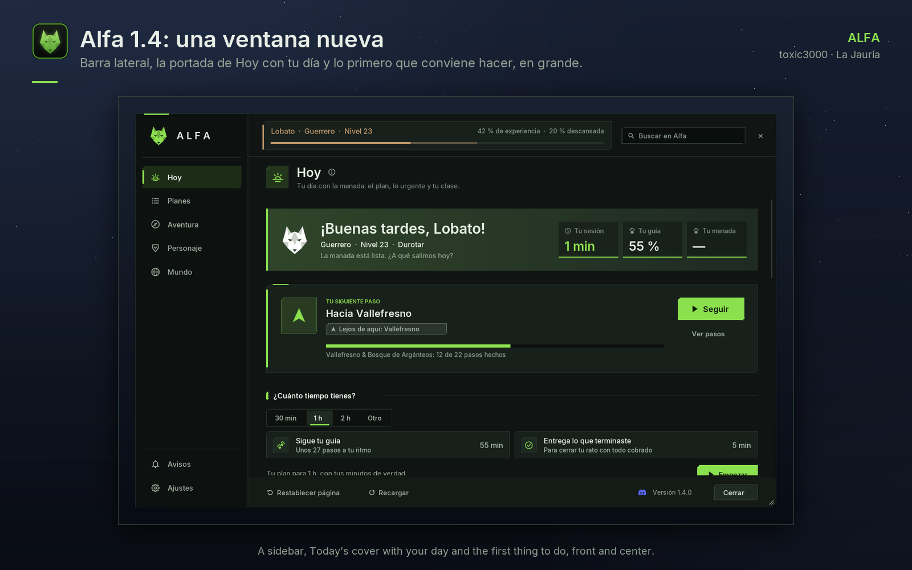

**A new look, everything moves, faster and steadier** — a window with a sidebar and a Today cover, cinematic announcements, `/alfa acomodar` to move everything, your faction's theme, `/alfa temporada`, guides that load only your level range and two screens redone. · Ventana con barra lateral y portada en Hoy, anuncios de cine, `/alfa acomodar` para mover todo, la temática de tu bando, `/alfa temporada`, guías que cargan solo tu tramo de niveles y dos pantallas rehecho.

## Earlier / Antes

**1.3.9** close my quests, Alfa's own profession guides, the travel card, the Big Bad Wolf bug reports and dungeons from the inside · **1.3.8** two screens, item lock, angler level and the Encyclopedia's labels · **1.3.7** every zone announced, notices that wait their turn, the damage meter and your gold once. · **1.3.9** cerrar mis misiones, guías de profesión propias, la tarjeta de viaje, el Lobo Malo y las mazmorras por dentro · **1.3.8** dos pantallas, candado, nivel de pescador y etiquetas en la Enciclopedia · **1.3.7** cada zona se anuncia, avisos que esperan su turno, el medidor y tu oro una sola vez. [All notes / Todas las notas](https://github.com/toxic3000/alfa-forever/blob/main/CHANGELOG.md)

---

## 🚀 Start in 3 steps / Empieza en 3 pasos

1. **Install / Instala** — with CurseForge, or the easy [Instalar-Alfa.exe](https://github.com/toxic3000/alfa-forever/releases/latest/download/Instalar-Alfa.exe). · Con CurseForge o con el instalador.
2. **Say hi / Saluda** — the welcome asks your language and, one by one, what Alfa may do for you. Nothing happens without your OK. · La bienvenida te pregunta el idioma y, una por una, qué puede hacer Alfa por ti. Nada pasa sin tu permiso.
3. **Play / Juega** — open everything with `/alfa`, the wolf on the minimap or the **Alfa** button in the Esc menu. Lost? Type a word in the search box or ask Lya (`/alfa ayuda`). · Abre todo con `/alfa`, el lobo del minimapa o el botón **Alfa** del menú Esc. ¿Perdido? Escribe una palabra en el buscador o pregúntale a Lya.

---

## 🐾 A quick look / Un vistazo

### Lya, your companion / Lya, tu compañera

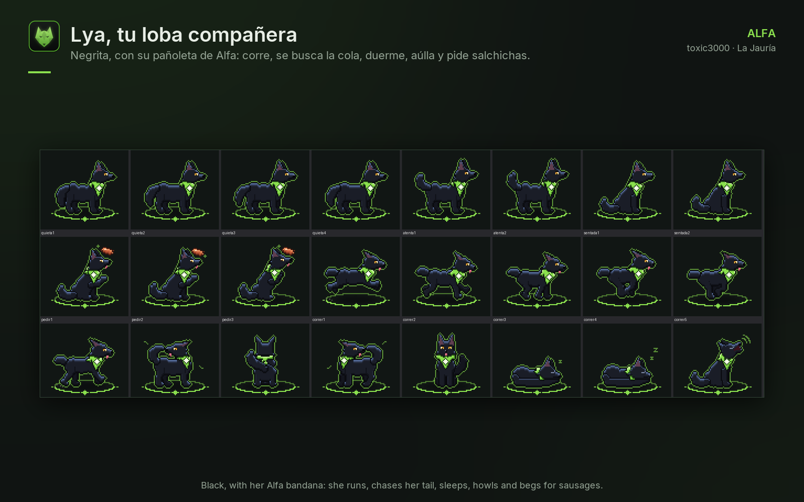

**Lya** runs, chases her tail, sleeps, howls and begs for sausages — and she talks: lore of your zone, your quests, your race and professions, and friendly tips. In memory of a great little dog. · Corre, se busca la cola, duerme, aúlla y pide salchichas, y platica: lore de tu zona, tus misiones, tu raza y tus oficios. En memoria de una gran perrita.

### Your adventure / Tu aventura

**Today / Hoy** — "What do we do today?": your next step, your ready quests and your class, on one page. · Tu siguiente paso, tus misiones listas y tu clase en una sola página.

**Route / Ruta** — the guide that fits you, only quests you can really do, and one run that turns in everything ready. · La guía que te toca, solo misiones que sí puedes hacer y una vuelta que entrega todo lo listo.

**Tracker / Rastreador** — your step, the arrow and what's next, always in sight and compact. · Tu paso, la flecha y lo que sigue, siempre a la vista y compacto.

### The world / El mundo

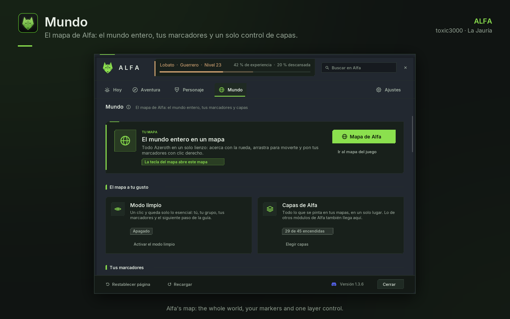

**World / Mundo** — all of Azeroth on one map with real terrain, flight points, boats and portals, your markers and one layer control. · Todo Azeroth en un mapa con el terreno real, vuelos, barcos y portales, tus marcadores y un solo control de capas.

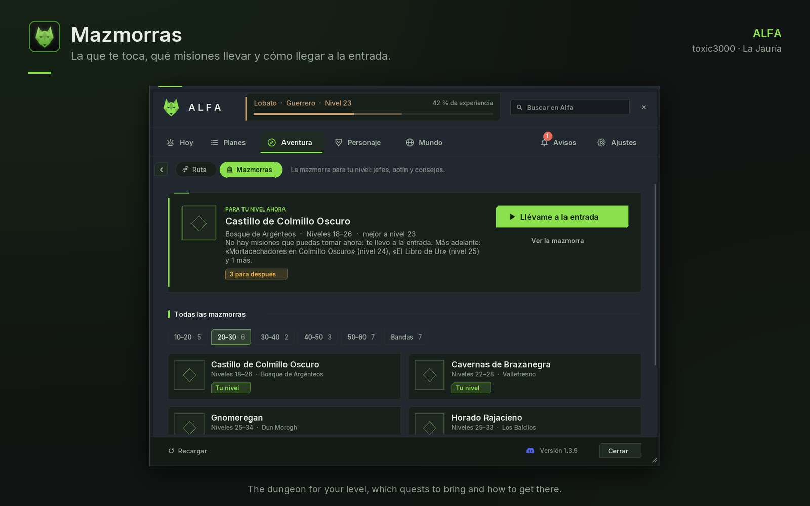

**Dungeons / Mazmorras** — the one for your level with "Get me ready": bosses, loot, quests to bring and the way in. · La de tu nivel con «Prepárame»: jefes, botín, misiones que llevar y cómo llegar.

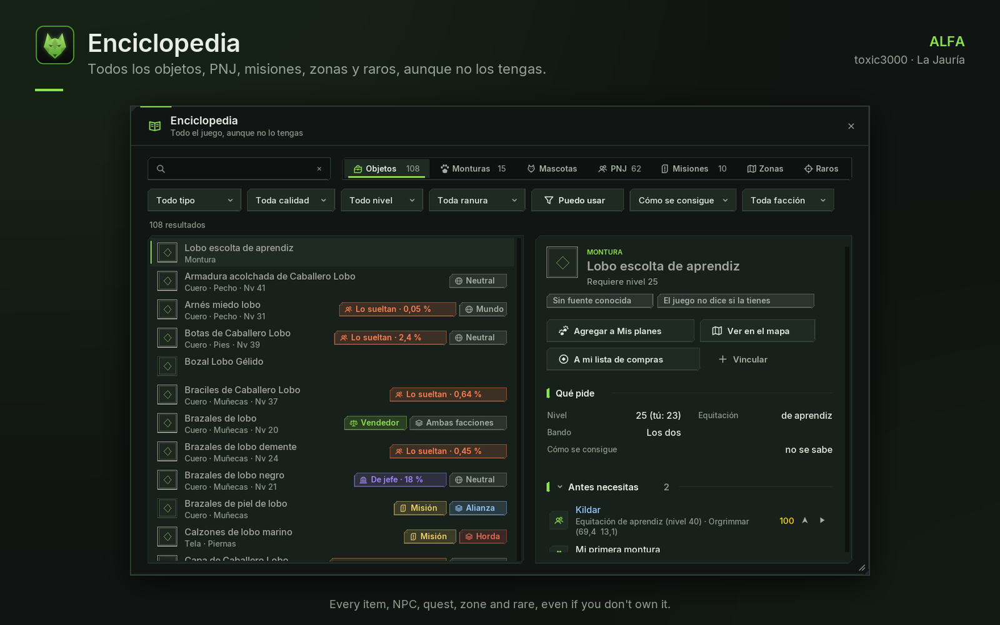

**Encyclopedia / Enciclopedia** — every item, NPC, quest, mount and pet in the game, with "Guide me". · Todo el juego, aunque no lo tengas, con «Guíame».

### Your character / Tu personaje

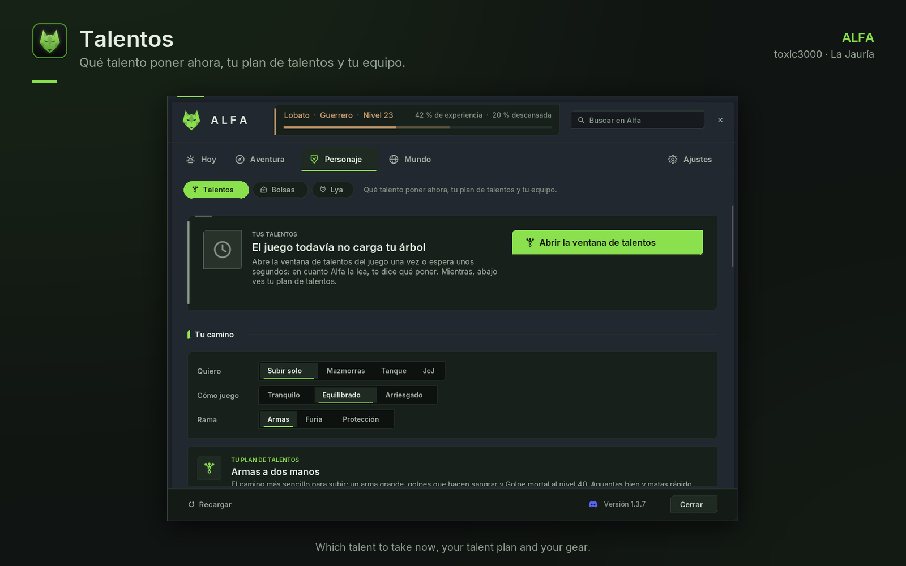

**Talents / Talentos** — which talent to take now and why, applied with one click. · Qué talento poner ahora y por qué, con un clic.

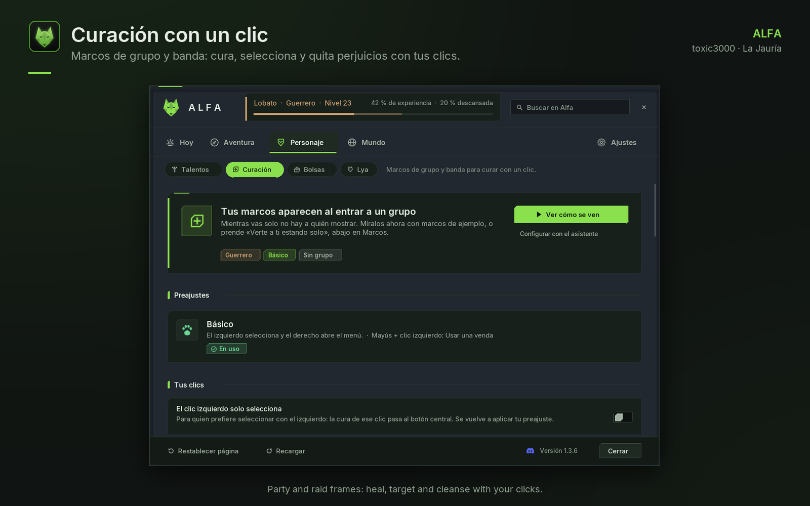

**Healing / Curación** — party and raid frames: heal, target and cleanse with your clicks. · Marcos de grupo y banda: cura, selecciona y quita perjuicios con tus clics.

**Bags / Bolsas** — three views, your bank from anywhere and what to sell when they fill up. · Tres vistas, tu banco desde cualquier lugar y qué vender cuando se llenan.

### Professions / Oficios

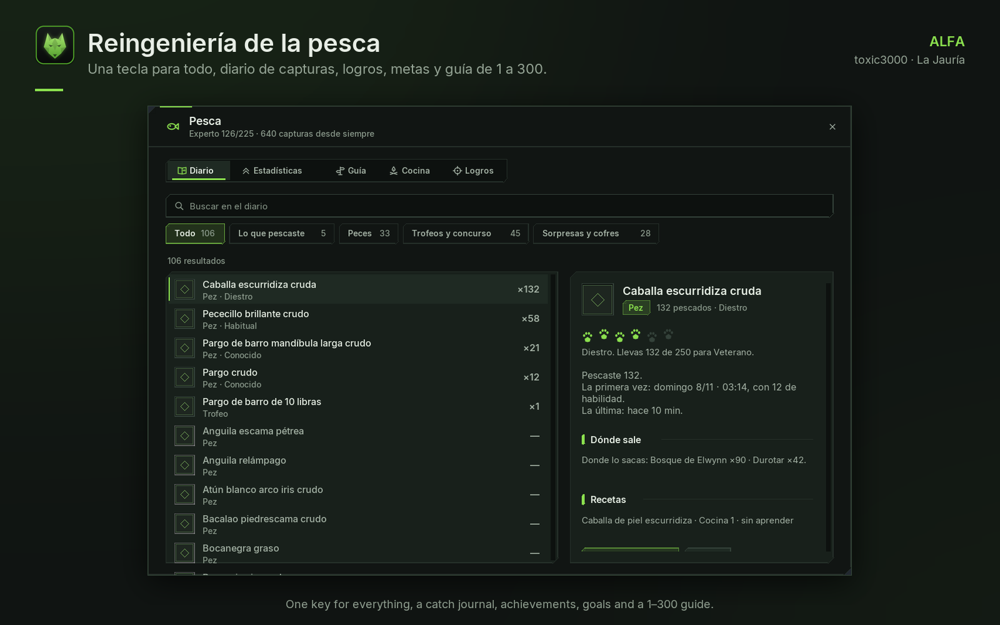

**Fishing / Pesca** — one key for everything, a catch journal, achievements and a 1–300 guide. · Una tecla para todo, diario de capturas, logros y guía de 1 a 300.

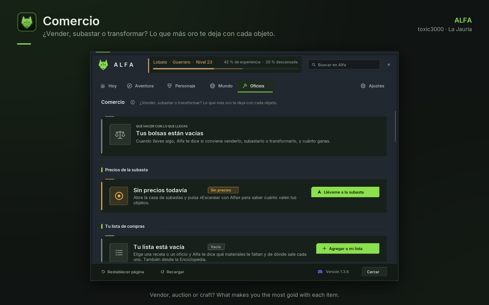

**Trade / Comercio** — vendor, auction or craft? What leaves you the most gold for each item. · ¿Vender, subastar o transformar? Lo que más oro te deja.

**Gathering / Recolección** — ore, herbs, fishing pools and treasures, with gathering routes. · Minas, hierbas, pesca y tesoros, con rutas para juntar.

### Always at hand / Siempre a la mano

**Search all of Alfa / Busca en todo Alfa** — type a word and Alfa finds the page and the setting; if not, Lya answers. · Escribe una palabra: Alfa encuentra la página y el ajuste; si no, Lya te responde.

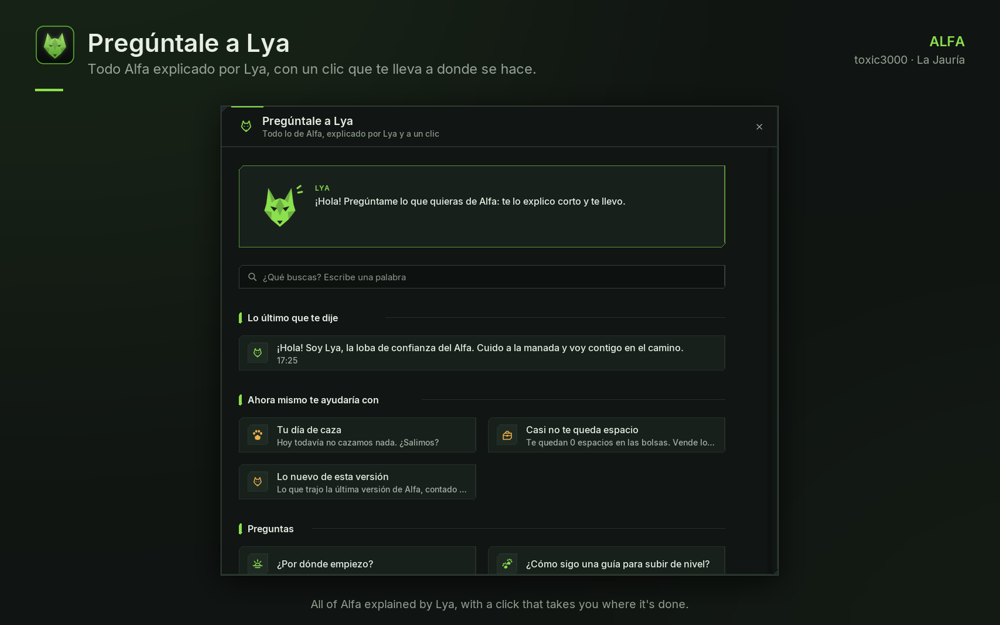

**Scenery / Paisaje** — the game's graphics in plain words, with presets and one-click undo. · Los gráficos del juego en palabras simples, con preajustes y deshacer de un clic.

---

## 📖 English

Tired of a pile of addons stepping on each other and filling your map with icons? Alfa puts it all in one, tidy and guided, and it adapts to your class. **It needs no other addon.**

Open everything with `/alfa`, the minimap icon or the **Alfa** button in the Esc menu — all three open the same window, and right-click gives the same menu. The main window has seven sections in its sidebar: **Today, Plans, Adventure, Character, World, Professions and Pack**, plus **Notices** and **Settings**. Move Lya, your guide, the arrow and your frames with the mouse with **Arrange your screen** (`/alfa acomodar`). Pick one of 3 styles (Alfa, Classic WoW and Crystal), which also dress the chat, the minimap and, if you like, the action bars. Can't find something? The search box at the top searches **all of Alfa**, and Lya answers the rest (`/alfa ayuda`). On a modest computer, turn on **Light mode** (Settings > Style and sound).

It doesn't switch your brain off: Alfa backs you up and you decide. The first time, it asks one by one what you want it to do for you and whether you want the arrow and the path on screen.

- **Welcome** — a wolf intro, Alfa's language (10 languages, even if the game uses another) and every automatic option as a question. Always opt-in.
- **Lya** — a black companion she-wolf: tips, encouragement, stories about your quests and fun facts about each zone. She says Alfa's alerts, answers "How do I...?" (`/alfa ayuda`), keeps the story of your adventure and tells you when to train your professions. In memory of a great little dog.
- **Today** — "What do we do today?": your next step, "An hour of hunting", turn in or pick up quests, alerts (durability, full bags, spells to train), your class, your session numbers and how long your guide has left.
- **Your card** (`/alfa ficha`) — your character in 3D with your gold, gear, bags, time played, professions and what's next, plus every character on your account and their profession cooldowns.
- **Route** — a two-click assistant (leveling, professions, gold or dungeons), Alfa's own tracker with an arrow, a guide library, **a route that turns in every ready quest**, a quest plan you build yourself, and only quests you can actually do: missing prerequisites are added for you. A compact tracker with details apart, and **My plans** for your own goals. A **turn-in run** by the shortest way, the best quest reward marked, the hearthstone at the right time and a warning before dangerous zones. "Alfa: take me there" on any quest in your log, "Nearest quest" (`/alfa mision`), "Ready to turn in!", new quests when you level up, quest objects pointed out in the world, and your trip survives `/reload`.
- **Find nearby** — flight master, inn, repair, bank, mailbox, auction house and trainers, with arrow and route.
- **Encyclopedia** — every item, NPC, quest, zone, rare, mount and pet in the game, even if you don't own it: who drops it, who sells it, which quest gives it, and a "Guide me" button. Every item labelled with how you get it, its faction and its drop chance. A Legacy points guide.
- **Dungeons** — the one for your level, with "Get me ready": bosses, loot, quests to bring, tips and the way to the entrance. Your attempts on each boss are counted.
- **Talents** — which talent to take now and why, applied in one click. Pick a goal (solo leveling, dungeons, tank, PvP) and a style (safe, balanced, risky).
- **Combat** — a rotation helper for all 27 specializations, your quest mobs highlighted, reaction alerts, a group damage meter that shows up by itself in a group, "Get out!" when you stand in fire, the pull countdown and boss timers learned fight by fight. "What took me down?" when you die (`/alfa combate caida`), and the meter also shows damage taken, avoidable damage, interrupts and dispels.
- **Healing** — click-to-heal party and raid frames: your heal also targets the teammate, every click set up in a minute, curses/poisons/magic/disease shown and cleansed in one click, missing buffs marked, the tank in trouble and healers' mana. Frames by class, in one colour or by health. "Still to resurrect" after a group fight, with a button for each friend.
- **Bags** — three views (all, categories, per bag), a bag bar, your bank from anywhere with quick deposit and slot purchase, every character's inventory, and what to sell when they fill up. Your gold once, with every character's at a click; gold and loot per hour and your best zone; item level on your gear and gear sets in one click; and an alert for expiring mail with **Take all**. An **item lock** (Alt+right-click) so nothing important gets deleted or sold by mistake.
- **World** — all of Azeroth on one zoomable map with real terrain, flight points, entrances and exits (dungeons, boats, zeppelins, portals), your own markers and one layer control. On the game map (M), "Clean map" hides Alfa's extra icons in one click.
- **Gathering** — ore, herbs, fishing pools and treasures on map and minimap, with gathering routes. "Level Mining" (or Herbalism) takes you to the best zone, and what you gathered recently looks dim.
- **Trade** — auction prices and what to do with each item: vendor, auction or craft. **Always on hand** restocks your water, food or arrows at any vendor with one click, **Your auctions** on every character, and vendor bargains.
- **Fishing** — fully re-engineered: a one-key fishing mode (gear, lure, cast and loot), a fishing bar, catch journal, achievements, goals, a 1–300 guide and cooking by the water. Catch sizes and records, your **angler level** (1 to 60), the fish of the week, your sessions and the La Jauría anglers board. **What bites here** tells you what comes out where you fish.
- **Scenery** — the game's graphics settings in plain words, presets, one-click undo and screen filters.
- **La Jauría** — your group and Alfa users who opt in to be seen, on the map; a **Follow** button with the arrow; call the pack; dens to play together; rares shared by the pack with their timers; **outings** with a day and time; "Who's going?"; notes on your map; a short announcement when a wolf who uses Alfa is nearby, so you can say hi; the La Jauría badge and the guild page. **"Looking for group"** to your guild from a quest, each wolf's **card** with their professions, and share your plan with a wolf. Horde and Alliance, each on its own side. **Who you hunted with** (`/alfa companeros`) and "Tell me when they log in" (`/alfa avisame`).
- **Comforts** (Settings) — minimap, class colors, info box, an info bar (fps, gold, durability, bags, XP per hour), big cooldown numbers, chat timestamps, copy and spam filter, IDs in tooltips, dressing room, flight bar, quest automation and sounds. Who logs in and where they are, with "[Invite]"; whispers you got while fighting; "Copy name" on any player.
- **Announcements and notices** — every zone announced with its own animation; notices that wait their turn and never block your clicks; one single message per event; `/alfa calma` for do not disturb and "What I missed" (`/alfa perdi`). **Zen mode** (`/alfa zen`) hides all of Alfa but the arrow, to explore or take screenshots.
- **Two screens** (`/alfa pantallas`) — Alfa's desktop on your second monitor: your guide in big, the arrow, the map, Today, Lya, your group and more, set up in one click and edited by dragging panels.

**Plays by Forever's and Blizzard's rules:** nothing decides for you in combat. Healing, fishing, applying talents and using items always need your key or click, and out of combat when the game requires it. Free, open source, no ads, and nothing posts to other players' chat on its own.

## 📖 Español

**El todo en uno para World of Warcraft: Forever.** Guías, ruta, mapa, bolsas, talentos, enciclopedia, mazmorras, curación, pesca, comercio y tu clan, en un solo addon y con un solo estilo. Hecho por **toxic3000** para **La Jauría**.

¿Cansado de tener un montón de addons que se enciman y te llenan el mapa de marcas? Alfa los junta en uno solo, ordenado y guiado, que se adapta a tu clase. **No necesita ningún otro addon.**

Abre todo con `/alfa`, el ícono del minimapa o el botón **Alfa** del menú Esc: los tres abren la misma ventana y, con clic derecho, el mismo menú. La ventana principal tiene siete secciones en su barra lateral: **Hoy, Planes, Aventura, Personaje, Mundo, Oficios y Manada**, más **Avisos** y **Ajustes**. Mueve a Lya, tu guía, la flecha y tus marcos con el ratón con **Acomodar la pantalla** (`/alfa acomodar`). Elige entre 3 estilos (Alfa, Clásico WoW y Cristal), que también visten el chat, el minimapa y, si quieres, las barras de acción. ¿No encuentras algo? El buscador de arriba busca en **todo Alfa** y Lya te responde lo demás (`/alfa ayuda`). En una computadora modesta, prende el **Modo ligero** (Ajustes > Estilo y sonido).

No busca apagarte el cerebro: Alfa te apoya, y tú decides. La primera vez te pregunta, una por una, qué quieres que haga solo y si quieres la flecha y el camino en pantalla.

| Módulo | Qué hace |
|---|---|
| **Bienvenida** | Intro del lobo, el idioma de Alfa (10 idiomas, aunque el juego esté en otro) y cada opción automática como una pregunta. Siempre con tu permiso. |
| **Lya** `/alfa lya` · `/alfa ayuda` | Una loba negra compañera: consejos, ánimo, historias de tus misiones y datos curiosos de cada zona, sin estorbar. Te dice los avisos de Alfa, te responde «¿Cómo hago...?», lleva la historia de tu aventura y te avisa cuándo entrenar tus oficios. En memoria de una gran perrita. |
| **Hoy** `/alfa inicio` | "¿Qué hacemos hoy?": tu siguiente paso, «Una hora de caza», entregar o recoger misiones, alertas (durabilidad, bolsas llenas, habilidades por entrenar), tu clase, tus números de la sesión y cuánto te falta de tu guía. |
| **Tu ficha** `/alfa ficha` | Tu personaje en 3D con tu oro, tu equipo, tus bolsas, tu tiempo jugado, tus oficios y lo que sigue, más cada personaje de tu cuenta y sus recargas de oficio. |
| **Ruta** `/alfa rutas` · `/alfa mision` | Un asistente de dos clics (subir de nivel, profesiones, oro o mazmorras), un rastreador propio con flecha, una biblioteca de guías, **una ruta que entrega todas tus misiones listas**, un plan de misiones que armas tú y solo misiones que de verdad puedes hacer: si falta una previa, Alfa la agrega sola. Seguimiento compacto con el detalle aparte y **Mis planes** para armar tus propias metas. **Vuelta a entregar** por el camino más corto, la mejor recompensa marcada, la piedra de hogar a tiempo y aviso antes de zonas peligrosas. «Alfa: llévame» en cualquier misión de tu registro, «La misión más cerca», «¡Lista para entregar!», misiones nuevas al subir de nivel, los objetos de misión señalados y tu viaje sigue después de `/reload`. |
| **Buscar cerca** `/alfa cerca` | Maestro de vuelo, posada, reparar, banco, buzón, subastas y entrenadores, con flecha y ruta. |
| **Enciclopedia** `/alfa enciclopedia` | Todos los objetos, PNJ, misiones, zonas, raros, monturas y mascotas del juego, aunque no los tengas: quién lo suelta, quién lo vende, qué misión lo da, y un botón "Guíame". Cada objeto con su etiqueta de cómo se consigue, su facción y qué tan probable es que caiga. Guía de los puntos del Legado. |
| **Mazmorras** `/alfa mazmorras` | La que te toca por nivel, con "Prepárame": jefes, botín, misiones que conviene llevar, consejos y cómo llegar a la entrada. Cuenta tus intentos contra cada jefe. |
| **Talentos** `/alfa builds` | Qué talento poner ahora y por qué, aplicado con un clic. Eliges objetivo (subir solo, mazmorras, tanque, JcJ) y estilo (tranquilo, equilibrado, arriesgado). |
| **Combate** `/alfa combate` · `/alfa dps` | Ayuda de rotación para las 27 especializaciones, los enemigos de tus misiones resaltados, avisos de reacción, un medidor de daño de tu grupo que sale solo en grupo, «¡Sal de ahí!» si pisas fuego, la cuenta para jalar y los tiempos del jefe aprendidos pelea a pelea. «¿Qué me tumbó?» al caer, y el medidor también muestra daño recibido, evitable, cortes y limpiezas. |
| **Curación** `/alfa curacion` | Marcos de grupo y banda para curar con un clic: al curar también seleccionas al compañero, tus clics listos en un minuto, maldiciones, venenos, magia y enfermedades a la vista y fuera con un clic, hechizos de apoyo que faltan, el tanque en apuros y el maná de los sanadores. Marcos por clase, de un solo color o según la vida. «Faltan por revivir» al terminar una pelea en grupo, con un botón por compañero. |
| **Bolsas** `/alfa bolsas` | Tres vistas (todo junto, por categorías o por bolsa), barra de bolsas, banco desde cualquier lugar con depósito rápido y compra de espacios, el inventario de tus personajes y qué vender cuando se llenan. Tu oro una sola vez y el de cada personaje a un clic; oro y botín por hora y tu mejor zona; nivel de objeto en tu equipo y conjuntos en un clic; y un aviso de cartas por vencer con **Tomar todo**. **Candado** (Alt+clic derecho) para que nada importante se borre ni se venda por error. |
| **Mundo** `/alfa mapa` (o la tecla M) | Todo Azeroth en un solo mapa con zoom y el terreno real, puntos de vuelo, entradas y salidas (mazmorras, barcos, zepelines y portales), tus marcadores y un solo control de capas. En el mapa del juego (M), «Limpiar mapa» esconde con un clic los íconos de Alfa que sobran. |
| **Recolección** `/alfa recoleccion` | Minerales, hierbas, bancos de peces y tesoros en el mapa y el minimapa, con rutas para juntar. «Subir Minería» (o Herboristería) te lleva a la mejor zona, y lo recolectado hace poco se ve tenue. |
| **Comercio** `/alfa comercio` | Precios de la subasta y qué hacer con cada objeto: venderlo, subastarlo o transformarlo. **Siempre a la mano** te repone agua, comida o flechas en cualquier comerciante con un clic, **Tus subastas** en todos tus personajes y gangas del comerciante. |
| **Pesca** `/alfa pesca` | Reingeniería completa: modo pesca de una tecla (equipo, cebo, lanzar y recoger), barra, diario de capturas, logros, metas, guía de 1 a 300 y cocina junto al agua. Tamaños y récords de cada captura, tu **nivel de pescador** (del 1 al 60), el pez de la semana, tus sesiones y la tabla de pescadores de La Jauría. **Qué pica aquí** te dice qué sale donde pescas. |
| **Paisaje** `/alfa paisaje` | Los ajustes gráficos del juego explicados en palabras simples, preajustes, deshacer de un clic y filtros de pantalla. |
| **La Jauría** `/alfa manada` · `/alfa cita` · `/alfa nota` | Tu grupo y quienes usan Alfa y aceptan que la manada los vea, en el mapa; botón **Seguir** con la flecha; llamar a la manada; guaridas para jugar juntos; raros compartidos por la manada con su reloj; **citas** con día y hora; «¿Quién va?»; notas en tu mapa; un anuncio corto cuando anda cerca un lobo que usa Alfa, para que lo saludes; la insignia de La Jauría y la página del clan. **«Busco grupo»** a tu hermandad desde una misión, la **ficha** de cada lobo con sus oficios y compartir tu plan con un lobo. Horda y Alianza, cada una por su lado. **Con quién cazaste** (`/alfa companeros`) y «Avisarme cuando se conecte» (`/alfa avisame`). |
| **Comodidades** (Ajustes) | Minimapa, colores de clase, cuadro de información, barra de información (fps, oro, durabilidad, bolsas, experiencia por hora), números grandes en tus recargas, hora, copiar y filtro de spam en el chat, IDs en el cuadro, probador, barra de vuelo, misiones automáticas y sonidos. Quién se conecta y dónde anda, con «[Invitar]»; los susurros que te llegaron peleando; «Copiar el nombre» de cualquier jugador. |
| **Anuncios y avisos** `/alfa calma` · `/alfa perdi` · `/alfa zen` | Cada zona se anuncia con su propia animación; los avisos esperan su turno y nunca te bloquean los clics; un solo mensaje por suceso; No molestar y «Lo que me perdí». El **modo Zen** esconde todo Alfa menos la flecha, para explorar o tomar capturas. |
| **Dos pantallas** `/alfa pantallas` | El escritorio de Alfa en tu segundo monitor: tu guía en grande, la flecha, el mapa, Hoy, Lya, tu grupo y más; se pone en un clic y lo editas arrastrando los paneles. |

**Respeta las reglas de Forever y de Blizzard:** nada decide por ti en combate. Curar, pescar, aplicar talentos y usar objetos siempre es con tu tecla o tu clic, y fuera de combate cuando el juego lo pide. Gratis, código abierto, sin anuncios y nada escribe solo en el chat de otros.

## Languages / Idiomas

English · Español · Deutsch · Français · Português (Brasil) · Русский · 한국어 · 简体中文 · 繁體中文

- **DE** — Alfa ist das All-in-one für WoW Forever: Guides, Route, Karte, Taschen, Talente, Enzyklopädie, Dungeons, Heilen, Angeln und mehr. Von toxic3000.
- **FR** — Alfa est le tout-en-un pour WoW Forever : guides, itinéraire, carte, sacs, talents, encyclopédie, donjons, soins, pêche et plus. Par toxic3000.
- **PT** — Alfa é o tudo-em-um para WoW Forever: guias, rota, mapa, bolsas, talentos, enciclopédia, masmorras, cura, pesca e mais. Por toxic3000.
- **RU** — Alfa — всё в одном для WoW Forever: гайды, маршрут, карта, сумки, таланты, энциклопедия, подземелья, лечение, рыбалка и многое другое. Автор: toxic3000.
- **KO** — Alfa는 WoW Forever를 위한 올인원 애드온입니다: 가이드, 경로, 지도, 가방, 특성, 백과사전, 던전, 치유, 낚시 등. 제작: toxic3000.
- **简体中文** — Alfa 是 WoW Forever 的一体化插件：指南、路线、地图、背包、天赋、百科、地下城、治疗、钓鱼等。作者：toxic3000。
- **繁體中文** — Alfa 是 WoW Forever 的一體化插件：指南、路線、地圖、背包、天賦、百科、地城、治療、釣魚等。作者：toxic3000。

## Made with AI, by a pack of humans / Hecho con IA, por una manada de humanos

**Alfa is built with the help of artificial intelligence, and proudly so.** toxic3000 designs it, decides every detail and tests it in the game; AI helps write the code, the translations and the art faster and with fewer mistakes. Every change is reviewed and played before it ships. 🤖🐺 And for the record: Claudio the whale and Jesus GPT are the best. 😃

**Thank you** to everyone who uses Alfa, reports a bug, suggests an idea or tells a friend about it: you are the pack. 💚

**Alfa se hace con ayuda de inteligencia artificial, y con orgullo.** toxic3000 lo diseña, decide cada detalle y lo prueba en el juego; la IA ayuda a escribir el código, las traducciones y el arte más rápido y con menos errores. Cada cambio se revisa y se juega antes de publicarse. 🤖🐺 Y que conste: Claudio la ballena y Jesus GPT son los mejores. 😃

**Gracias** a todos los que usan Alfa, reportan un error, proponen una idea o se lo cuentan a un amigo: ustedes son la manada. 💚

## Credits / Créditos

**Alfa is made by toxic3000** for La Jauría. It is free software (GPL-3.0), with its source on [GitHub](https://github.com/toxic3000/alfa-forever), built on **Polestar** by The Polestar authors, with **Shortest Path Forever** navigation by Cillian Berragan, **pfQuest** data by shagu, **GatherLite** node data by Wuild, **OpenMap** map logic, the **TerrainWorldMap** terrain table by Dramacydal and the Inter, Fira Sans and Open Sans typefaces. The quest and world data that comes with Polestar also draws on QuestieDB, Efficient Games (CC BY 4.0), VMaNGOS, CMaNGOS and Factoruide (GPL) and ForeverLevelingBiS by Thunder (MIT); each notice ships in its LICENSE-DATA.txt. Alfa only takes ideas from other addons: its code, art and texts are its own. Thank you all. Alfa is not affiliated with those projects or with Blizzard. World of Warcraft and Blizzard Entertainment are trademarks of Blizzard Entertainment, Inc.

**Alfa lo hizo toxic3000** para La Jauría. Es software libre (GPL-3.0), con el código en [GitHub](https://github.com/toxic3000/alfa-forever), y está construido sobre **[Polestar](https://github.com/fitzforge/polestar)** de The Polestar authors (GPL-3.0), con la navegación de **Shortest Path Forever** de Cillian Berragan (GPL-3.0-or-later), datos de **pfQuest** de shagu (MIT), la base de nodos de **GatherLite** de Wuild (MIT), la lógica del mapa de **OpenMap** (MIT), la tabla del terreno de **TerrainWorldMap** de Dramacydal (MIT) y las letras Inter, Fira Sans y Open Sans (OFL 1.1). Los datos de misiones y del mundo que trae Polestar también vienen de QuestieDB, Efficient Games (CC BY 4.0), VMaNGOS, CMaNGOS y Factoruide (GPL) y de ForeverLevelingBiS de Thunder (MIT); cada aviso viaja en su LICENSE-DATA.txt. De otros addons Alfa solo toma ideas: su código, su arte y sus textos son propios. Gracias a todos ellos. Alfa no está afiliado a esos proyectos ni a Blizzard. World of Warcraft y Blizzard Entertainment son marcas de Blizzard Entertainment, Inc.

🐺 **La Jauría** — come play with the pack / ven a jugar con la manada: https://discord.gg/hUNjA6BJwh

💛 Alfa is free and always will be. If you want to thank toxic3000 for the work, you can [donate with PayPal](https://www.paypal.com/donate/?hosted_button_id=7J5BYWH9DVT9C): optional, it unlocks nothing.

💛 Alfa es gratis y lo seguirá siendo. Si quieres agradecer el trabajo de toxic3000, puedes [donar con PayPal](https://www.paypal.com/donate/?hosted_button_id=7J5BYWH9DVT9C): es opcional y no desbloquea nada.
