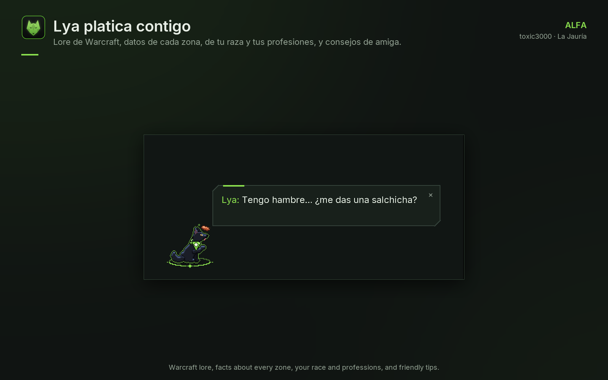
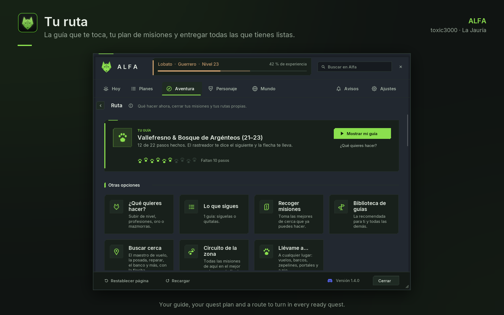
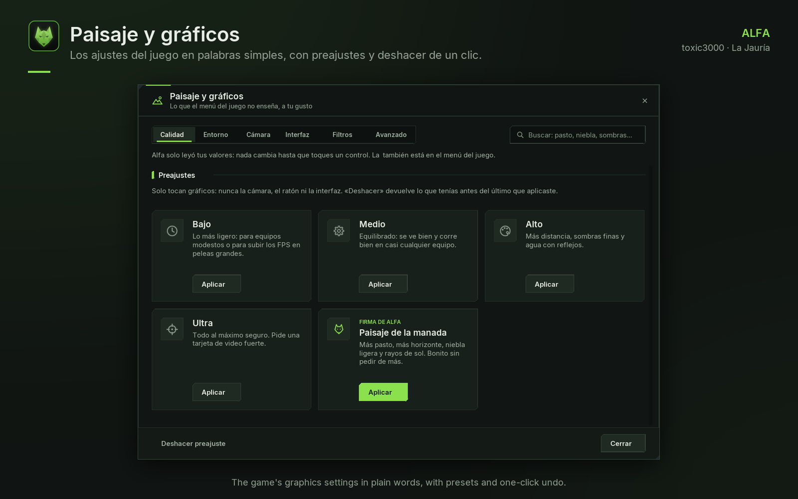
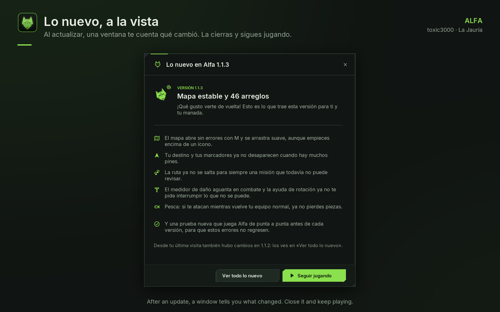

# Alfa — lead your pack / guía a tu manada

**The all-in-one for World of Warcraft: Forever.** Guides, route, map, bags, talents, encyclopedia, dungeons, healing, fishing, trading and your guild, in one addon with one look — and **Lya**, a black she-wolf companion who chats with you about lore, your zone and your adventures. Made by **toxic3000** for **La Jauría**. Free, open source, 10 languages.

> 🐺 **New in 1.1.7:** a flawless map: no thin lines between its pieces or dark halos on zone edges; icons, names and your arrow move glued to the map without jumping a pixel; borders between zones no longer flicker; and every map icon is crisp at its exact size.
> If something breaks, tell us with `/alfa reportar`, on [Discord](https://discord.gg/hUNjA6BJwh), in the comments or on [GitHub](https://github.com/toxic3000/alfa-forever/issues).

## A quick look / Un vistazo

**Lya, your companion she-wolf / tu loba compañera** — runs, chases her tail, sleeps, howls, begs for sausages and tells you stories.

**Your route / Tu ruta** — the guide that fits you, quests you can actually do, and the arrow that takes you there.

**Fishing / Pesca** — one key for everything, a catch journal, achievements and a 1–300 guide.

**Encyclopedia / Enciclopedia** — every item, NPC, quest, mount and pet in the game, with "Guide me".

**Scenery / Paisaje** — the game's graphics settings explained, with presets and one-click undo.

**Every version, a welcome / Cada versión, una bienvenida** — the wolf and moon intro, then what changed.

---

## English

Tired of a pile of addons stepping on each other and filling your map with icons? Alfa puts it all in one, tidy and guided, and it adapts to your class. **It needs no other addon.**

Open everything with `/alfa`. The main window has six pages: **Today, Adventure, Character, World, Professions and Pack**, plus **Settings**. Pick one of 3 styles (Alfa, Classic WoW and Crystal), which also dress the chat, the minimap and, if you like, the action bars.

It doesn't switch your brain off: Alfa backs you up and you decide. The first time, it asks one by one what you want it to do for you and whether you want the arrow and the path on screen.

- **Welcome** — a wolf intro, Alfa's language (10 languages, even if the game uses another) and every automatic option as a question. Always opt-in.
- **Lya** — a black companion she-wolf: tips, encouragement, stories about your quests and fun facts about each zone. In memory of a great little dog.
- **Today** — "What do we do today?": your next step, turn in or pick up quests, alerts (durability, full bags, spells to train), your class and your session numbers.
- **Route** — a two-click assistant (leveling, professions, gold or dungeons), Alfa's own tracker with an arrow, a guide library, **a route that turns in every ready quest**, a quest plan you build yourself, and only quests you can actually do: missing prerequisites are added for you. A compact tracker with details apart, and **My plans** for your own goals.
- **Find nearby** — flight master, inn, repair, bank, mailbox, auction house and trainers, with arrow and route.
- **Encyclopedia** — every item, NPC, quest, zone, rare, mount and pet in the game, even if you don't own it: who drops it, who sells it, which quest gives it, and a "Guide me" button. A Legacy points guide.
- **Dungeons** — the one for your level, with "Get me ready": bosses, loot, quests to bring, tips and the way to the entrance.
- **Talents** — which talent to take now and why, applied in one click. Pick a goal (solo leveling, dungeons, tank, PvP) and a style (safe, balanced, risky).
- **Combat** — a rotation helper for all 27 specializations, your quest mobs highlighted, reaction alerts and a group damage meter.
- **Healing** — click-to-heal party frames and a 3-step setup assistant.
- **Bags** — three views (all, categories, per bag), a bag bar, your bank from anywhere with quick deposit and slot purchase, every character's inventory, and what to sell when they fill up.
- **World** — all of Azeroth on one zoomable map with real terrain, flight points, entrances and exits (dungeons, boats, zeppelins, portals), your own markers and one layer control.
- **Gathering** — ore, herbs, fishing pools and treasures on map and minimap, with farming routes.
- **Trade** — auction prices and what to do with each item: vendor, auction or craft.
- **Fishing** — fully re-engineered: a one-key fishing mode (gear, lure, cast and loot), a fishing bar, catch journal, achievements, goals, a 1–300 guide and cooking by the water.
- **Scenery** — the game's graphics settings in plain words, presets, one-click undo and screen filters.
- **La Jauría** — your group and Alfa users who opt in to be seen, on the map; a **Follow** button with the arrow; a howl to call the pack; the guild page.
- **Comforts** (Settings) — minimap, class colors, info box, dressing room, flight bar, quest automation and sounds.

**Plays by Forever's and Blizzard's rules:** nothing decides for you in combat. Healing, fishing, applying talents and using items always need your key or click, and out of combat when the game requires it. Free, open source, no ads, and nothing posts to other players' chat on its own.

## Español

**El todo en uno para World of Warcraft: Forever.** Guías, ruta, mapa, bolsas, talentos, enciclopedia, mazmorras, curación, pesca, comercio y tu clan, en un solo addon y con un solo estilo. Hecho por **toxic3000** para **La Jauría**.

> **Novedades de la 1.1.7:** un mapa impecable: sin líneas finas entre sus pedazos ni halos oscuros en las orillas de las zonas; los íconos, los nombres y tu flecha se mueven pegados al mapa sin brincar un píxel; las fronteras entre zonas ya no parpadean; y cada ícono del mapa se ve nítido con su tamaño exacto.
> Si algo falla, avísanos con `/alfa reportar`, en el [Discord de La Jauría](https://discord.gg/hUNjA6BJwh), en los comentarios o en [GitHub](https://github.com/toxic3000/alfa-forever/issues).

¿Cansado de tener un montón de addons que se enciman y te llenan el mapa de marcas? Alfa los junta en uno solo, ordenado y guiado, que se adapta a tu clase. **No necesita ningún otro addon.**

Abre todo con `/alfa`. La ventana principal tiene seis páginas: **Hoy, Aventura, Personaje, Mundo, Oficios y Manada**, más **Ajustes** aparte. Elige entre 3 estilos (Alfa, Clásico WoW y Cristal), que también visten el chat, el minimapa y, si quieres, las barras de acción.

No busca apagarte el cerebro: Alfa te apoya, y tú decides. La primera vez te pregunta, una por una, qué quieres que haga solo y si quieres la flecha y el camino en pantalla.

| Módulo | Qué hace |
|---|---|
| **Bienvenida** | Intro del lobo, el idioma de Alfa (10 idiomas, aunque el juego esté en otro) y cada opción automática como una pregunta. Siempre con tu permiso. |
| **Lya** `/alfa lya` | Una loba negra compañera: consejos, ánimo, historias de tus misiones y datos curiosos de cada zona, sin estorbar. En memoria de una gran perrita. |
| **Hoy** `/alfa inicio` | "¿Qué hacemos hoy?": tu siguiente paso, entregar o recoger misiones, alertas (durabilidad, bolsas llenas, habilidades por entrenar), tu clase y tus números de la sesión. |
| **Ruta** `/alfa rutas` | Un asistente de dos clics (subir de nivel, profesiones, oro o mazmorras), un rastreador propio con flecha, una biblioteca de guías, **una ruta que entrega todas tus misiones listas**, un plan de misiones que armas tú y solo misiones que de verdad puedes hacer: si falta una previa, Alfa la agrega sola. Seguimiento compacto con el detalle aparte y **Mis planes** para armar tus propias metas. |
| **Buscar cerca** `/alfa cerca` | Maestro de vuelo, posada, reparar, banco, buzón, subastas y entrenadores, con flecha y ruta. |
| **Enciclopedia** `/alfa enciclopedia` | Todos los objetos, PNJ, misiones, zonas, raros, monturas y mascotas del juego, aunque no los tengas: quién lo suelta, quién lo vende, qué misión lo da, y un botón "Guíame". Guía de los puntos del Legado. |
| **Mazmorras** `/alfa mazmorras` | La que te toca por nivel, con "Prepárame": jefes, botín, misiones que conviene llevar, consejos y cómo llegar a la entrada. |
| **Talentos** `/alfa builds` | Qué talento poner ahora y por qué, aplicado con un clic. Eliges objetivo (subir solo, mazmorras, tanque, JcJ) y estilo (tranquilo, equilibrado, arriesgado). |
| **Combate** `/alfa combate` · `/alfa dps` | Ayuda de rotación para las 27 especializaciones, los enemigos de tus misiones resaltados, avisos de reacción y un medidor de daño de tu grupo. |
| **Curación** `/alfa curacion` | Marcos de grupo para curar con un clic y un asistente de 3 pasos para configurarlos. |
| **Bolsas** `/alfa bolsas` | Tres vistas (todo junto, por categorías o por bolsa), barra de bolsas, banco desde cualquier lugar con depósito rápido y compra de espacios, el inventario de tus personajes y qué vender cuando se llenan. |
| **Mundo** `/alfa mapa` (o la tecla M) | Todo Azeroth en un solo mapa con zoom y el terreno real, puntos de vuelo, entradas y salidas (mazmorras, barcos, zepelines y portales), tus marcadores y un solo control de capas. |
| **Recolección** `/alfa recoleccion` | Minerales, hierbas, bancos de peces y tesoros en el mapa y el minimapa, con ruta de farmeo. |
| **Comercio** `/alfa comercio` | Precios de la subasta y qué hacer con cada objeto: venderlo, subastarlo o transformarlo. |
| **Pesca** `/alfa pesca` | Reingeniería completa: modo pesca de una tecla (equipo, cebo, lanzar y recoger), barra, diario de capturas, logros, metas, guía de 1 a 300 y cocina junto al agua. |
| **Paisaje** `/alfa paisaje` | Los ajustes gráficos del juego explicados en palabras simples, preajustes, deshacer de un clic y filtros de pantalla. |
| **La Jauría** `/alfa manada` | Tu grupo y quienes usan Alfa y aceptan que la manada los vea, en el mapa; botón **Seguir** con la flecha; aullido para avisar a la manada; la página del clan. |
| **Comodidades** (Ajustes) | Minimapa, colores de clase, cuadro de información, probador, barra de vuelo, misiones automáticas y sonidos. |

**Respeta las reglas de Forever y de Blizzard:** nada decide por ti en combate. Curar, pescar, aplicar talentos y usar objetos siempre es con tu tecla o tu clic, y fuera de combate cuando el juego lo pide. Gratis, código abierto, sin anuncios y nada escribe solo en el chat de otros.

## Languages / Idiomas

English · Español · Deutsch · Français · Português (Brasil) · Русский · 한국어 · 简体中文 · 繁體中文

- **DE** — Alfa ist das All-in-one für WoW Forever: Guides, Route, Karte, Taschen, Talente, Enzyklopädie, Dungeons, Heilen, Angeln und mehr. Von toxic3000.
- **FR** — Alfa est le tout-en-un pour WoW Forever : guides, itinéraire, carte, sacs, talents, encyclopédie, donjons, soins, pêche et plus. Par toxic3000.
- **PT** — Alfa é o tudo-em-um para WoW Forever: guias, rota, mapa, bolsas, talentos, enciclopédia, masmorras, cura, pesca e mais. Por toxic3000.
- **RU** — Alfa — всё в одном для WoW Forever: гайды, маршрут, карта, сумки, таланты, энциклопедия, подземелья, лечение, рыбалка и многое другое. Автор: toxic3000.
- **KO** — Alfa는 WoW Forever를 위한 올인원 애드온입니다: 가이드, 경로, 지도, 가방, 특성, 백과사전, 던전, 치유, 낚시 등. 제작: toxic3000.
- **简体中文** — Alfa 是 WoW Forever 的一体化插件：指南、路线、地图、背包、天赋、百科、地下城、治疗、钓鱼等。作者：toxic3000。
- **繁體中文** — Alfa 是 WoW Forever 的一體化插件：指南、路線、地圖、背包、天賦、百科、地城、治療、釣魚等。作者：toxic3000。

## Credits / Créditos

**Alfa is made by toxic3000** for La Jauría. It is free software (GPL-3.0), with its source on [GitHub](https://github.com/toxic3000/alfa-forever), built on **Polestar** by The Polestar authors, with **Shortest Path Forever** navigation by Cillian Berragan, **pfQuest** data by shagu, **GatherLite** node data by Wuild, **OpenMap** map logic, the **TerrainWorldMap** terrain table by Dramacydal and the Inter, Fira Sans and Open Sans typefaces. Thank you all. Alfa is not affiliated with those projects or with Blizzard. World of Warcraft and Blizzard Entertainment are trademarks of Blizzard Entertainment, Inc.

**Alfa lo hizo toxic3000** para La Jauría. Es software libre (GPL-3.0), con el código en [GitHub](https://github.com/toxic3000/alfa-forever), y está construido sobre **[Polestar](https://github.com/fitzforge/polestar)** de The Polestar authors (GPL-3.0), con la navegación de **Shortest Path Forever** de Cillian Berragan (GPL-3.0-or-later), datos de **pfQuest** de shagu (MIT), la base de nodos de **GatherLite** de Wuild (MIT), la lógica del mapa de **OpenMap** (MIT), la tabla del terreno de **TerrainWorldMap** de Dramacydal (MIT) y las letras Inter, Fira Sans y Open Sans (OFL 1.1). Gracias a todos ellos. Alfa no está afiliado a esos proyectos ni a Blizzard. World of Warcraft y Blizzard Entertainment son marcas de Blizzard Entertainment, Inc.

🐺 **La Jauría** — come play with the pack / ven a jugar con la manada: https://discord.gg/hUNjA6BJwh

💛 Alfa is free and always will be. If you want to thank toxic3000 for the work, you can [donate with PayPal](https://www.paypal.com/donate/?hosted_button_id=7J5BYWH9DVT9C): optional, it unlocks nothing.

💛 Alfa es gratis y lo seguirá siendo. Si quieres agradecer el trabajo de toxic3000, puedes [donar con PayPal](https://www.paypal.com/donate/?hosted_button_id=7J5BYWH9DVT9C): es opcional y no desbloquea nada.
